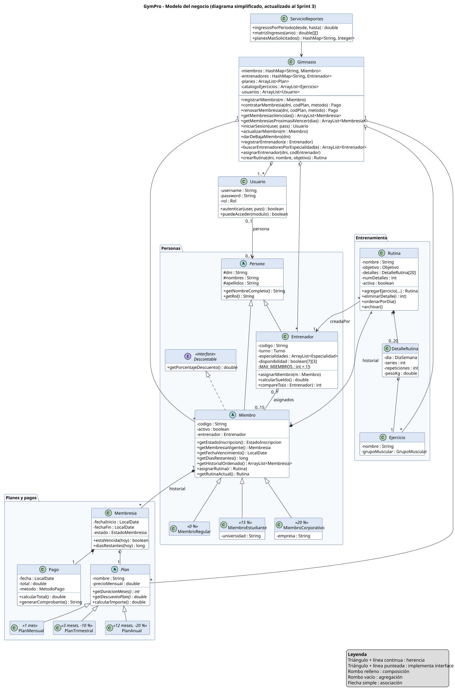

# GymPro — Sistema de Administración de un Gimnasio

**Universidad Nacional de San Agustín de Arequipa**
Escuela Profesional de Ingeniería de Sistemas
Curso: *Desarrollo de Software Orientado a Objetos* (2501211) — 2026-B
Proyecto final — Documento de especificación

---

## Índice

1. [Descripción general](#1-descripción-general)
2. [Objetivos](#2-objetivos)
3. [Actores del sistema](#3-actores-del-sistema)
4. [Requerimientos funcionales](#4-requerimientos-funcionales)
5. [Requerimientos no funcionales](#5-requerimientos-no-funcionales)
6. [Reglas de negocio](#6-reglas-de-negocio)
7. [Diseño orientado a objetos](#7-diseño-orientado-a-objetos)
8. [Relaciones entre clases](#8-relaciones-entre-clases)
9. [Correspondencia con los temas del sílabo](#9-correspondencia-con-los-temas-del-sílabo)
10. [Interfaz gráfica de usuario (GUI)](#10-interfaz-gráfica-de-usuario-gui)
11. [Manejo de archivos](#11-manejo-de-archivos)
12. [Base de datos](#12-base-de-datos-mysql--sqlite--jdbc)
13. [Manejo de excepciones](#13-manejo-de-excepciones)
14. [Metodología ágil (Scrum) y planificación](#14-metodología-ágil-scrum-y-planificación)
15. [Estructura de carpetas del proyecto](#15-estructura-de-carpetas-del-proyecto)
16. [Casos de prueba](#16-casos-de-prueba)
17. [Posibles extensiones](#17-posibles-extensiones)
18. [Anexo: archivos que acompañan este documento](#anexo-archivos-que-acompañan-este-documento)

---

## 1. Descripción general

**GymPro** es una aplicación de escritorio desarrollada en Java (Swing + JDBC) que permite administrar un gimnasio: sus miembros, entrenadores, planes, membresías, pagos, rutinas de entrenamiento y reportes administrativos.

El sistema va más allá del simple registro de clientes: controla el **ciclo de vida completo de una suscripción** (contratación, pago, vigencia, renovación, vencimiento) y la **planificación de entrenamientos** (rutinas compuestas por ejercicios con series, repeticiones, peso y día de la semana), además de ofrecer un panel de administración con indicadores y gráficos.

| Aspecto | Tecnología |
|---|---|
| Lenguaje | Java 17 o superior |
| Interfaz | Java Swing |
| Persistencia | Archivos de texto, binarios, serialización de objetos y base de datos relacional (MySQL o SQLite) mediante JDBC |
| Fechas | `java.time.LocalDate` |
| Control de versiones | Git + GitHub |
| Modelado | UML (PlantUML / draw.io) |

---

## 2. Objetivos

### Objetivo general

Desarrollar un sistema orientado a objetos que automatice la gestión de un gimnasio, aplicando todos los contenidos del curso: arreglos, colecciones, fundamentos de POO, agregación, composición, herencia, polimorfismo, interfaces gráficas, archivos, bases de datos y metodologías ágiles.

### Objetivos específicos

1. Registrar y consultar miembros y su estado de inscripción.
2. Controlar las fechas de vencimiento y el historial de membresías.
3. Definir planes (mensual, trimestral, anual) y calcular importes.
4. Registrar pagos y generar reportes de ingresos por periodo.
5. Registrar entrenadores con sus especialidades y asignarlos a miembros.
6. Crear rutinas con ejercicios, series y repeticiones; guardar su historial.
7. Mostrar indicadores: miembros activos, membresías próximas a vencer, planes más solicitados e ingresos por periodo.
8. Persistir la información en archivos y en una base de datos.

---

## 3. Actores del sistema

| Actor | Permisos |
|---|---|
| **Administrador** | Acceso total. Crea planes, registra entrenadores, consulta reportes de ingresos, hace respaldos y restauraciones. |
| **Recepcionista** | Registra miembros, contrata/renueva membresías, registra pagos y consulta vencimientos. |
| **Entrenador** | Consulta sus miembros asignados y crea/edita rutinas. |

Cada actor ingresa al sistema mediante usuario y contraseña (`VentanaLogin`). Según su rol, se habilitan o deshabilitan pestañas y opciones de menú.

---

## 4. Requerimientos funcionales

### A. Gestión de miembros

| ID | Requerimiento |
|---|---|
| RF-01 | Registrar miembro (DNI, nombres, apellidos, fecha de nacimiento, teléfono, email, peso, altura y tipo: Regular, Estudiante o Corporativo). |
| RF-02 | Modificar y dar de baja (lógica) a un miembro. |
| RF-03 | Buscar miembro por DNI (búsqueda binaria) o por apellido (búsqueda lineal / búsqueda en vivo en la tabla). |
| RF-04 | Consultar datos y estado de inscripción: `ACTIVO`, `POR_VENCER`, `VENCIDO` o `SIN_MEMBRESIA`. |
| RF-05 | Controlar la fecha de vencimiento de la membresía vigente y los días restantes. |
| RF-06 | Consultar el historial de membresías de un miembro. |
| RF-07 | Calcular el IMC del miembro (dato útil para el entrenador). |
| RF-08 | Importar miembros desde un archivo CSV y exportarlos a CSV. |

### B. Planes y pagos

| ID | Requerimiento |
|---|---|
| RF-09 | Crear, modificar y desactivar planes mensuales, trimestrales y anuales. |
| RF-10 | Contratar una membresía (miembro + plan) y registrar su pago. |
| RF-11 | Renovar una membresía (la nueva inicia al día siguiente de que termina la vigente, para no perder días). |
| RF-12 | Calcular el importe según: plan contratado, descuento por tipo de miembro, matrícula (primera vez) y recargo por método de pago. |
| RF-13 | Detectar membresías vencidas (actualización automática de estados al iniciar el sistema y a pedido). |
| RF-14 | Emitir comprobante de pago en archivo de texto (`.txt`). |
| RF-15 | Generar reportes de ingresos (por día, mes, año o rango de fechas). |

### C. Entrenadores y rutinas

| ID | Requerimiento |
|---|---|
| RF-16 | Registrar entrenadores con una o más especialidades, turno y disponibilidad semanal. |
| RF-17 | Asignar / reasignar un entrenador a un miembro (con límite de cupo). |
| RF-18 | Mantener un catálogo de ejercicios (nombre, grupo muscular, equipo). |
| RF-19 | Crear rutinas de entrenamiento para un miembro: agregar ejercicios con series, repeticiones, peso, descanso y día de la semana. |
| RF-20 | Modificar / eliminar ejercicios de una rutina y ordenarlos por día. |
| RF-21 | Consultar el historial de rutinas de un miembro (la rutina anterior se archiva cuando se asigna una nueva). |
| RF-22 | Exportar/imprimir la rutina en un archivo de texto para el miembro. |

### D. Administración del gimnasio

| ID | Requerimiento |
|---|---|
| RF-23 | Consultar los miembros activos. |
| RF-24 | Mostrar las membresías próximas a vencer (en los próximos N días, por defecto 7). |
| RF-25 | Analizar los planes más solicitados (conteo y porcentaje, gráfico). |
| RF-26 | Consultar los ingresos por periodo (tabla mes × tipo de plan y gráfico de barras). |
| RF-27 | Mostrar ranking de entrenadores según número de miembros asignados. |

### E. Seguridad y persistencia

| ID | Requerimiento |
|---|---|
| RF-28 | Iniciar sesión con usuario, contraseña y rol. |
| RF-29 | Guardar y cargar toda la información desde la base de datos. |
| RF-30 | Generar respaldo completo (archivo de objetos `.dat`) y restaurarlo. |
| RF-31 | Registrar un log binario de pagos (`pagos.bin`). |

---

## 5. Requerimientos no funcionales

| ID | Requerimiento |
|---|---|
| RNF-01 | La interfaz debe estar en español y ser intuitiva (pestañas, tablas, mensajes de confirmación con `JOptionPane`). |
| RNF-02 | Todos los datos de entrada se validan antes de guardarse; los errores se informan con mensajes claros (excepciones propias). |
| RNF-03 | El código respeta el encapsulamiento (atributos `private`, acceso por getters/setters) y la separación en capas: modelo, servicio, persistencia y gui. |
| RNF-04 | Los montos se muestran con 2 decimales y el símbolo "S/". |
| RNF-05 | El sistema debe funcionar aunque no exista conexión a la base de datos (modo archivo de respaldo). |
| RNF-06 | Código documentado con comentarios Javadoc en las clases principales. |

---

## 6. Reglas de negocio

**RN-01 — Planes** (precio mensual base de referencia: S/ 120.00)

| Plan | Duración | Descuento del plan | Importe ejemplo |
|---|---|---|---|
| MENSUAL | 1 mes | 0 % | S/ 120.00 |
| TRIMESTRAL | 3 meses | 10 % | S/ 324.00 |
| ANUAL | 12 meses | 20 % | S/ 1,152.00 |

Fórmula: `importePlan = precioMensual × meses × (1 − descuentoPlan)`.
El plan ANUAL incluye una evaluación nutricional gratuita.

**RN-02 — Descuento por tipo de miembro** (interface `Descontable`)

| Tipo | Descuento | Requisito |
|---|---|---|
| REGULAR | 0 % | — |
| ESTUDIANTE | 15 % | Código universitario |
| CORPORATIVO | 20 % | RUC de empresa con convenio |

**RN-03 — Matrícula:** S/ 50.00, se cobra sólo en la primera membresía.

**RN-04 — Recargo por método de pago** (enum `MetodoPago`): EFECTIVO 0 %, YAPE/PLIN 0 %, TRANSFERENCIA 0 %, TARJETA 3 %.

**RN-05 — Cálculo final del pago**

```
subtotal  = importePlan - importePlan * descuentoMiembro
subtotal += matrícula            (si es la primera vez)
total     = subtotal + subtotal * recargoMetodoPago
```

> **Ejemplo:** Estudiante, plan Trimestral, primera vez, tarjeta
> 324.00 − 48.60 = 275.40 → + 50.00 = 325.40 → + 3 % = **S/ 335.16**

**RN-06 —** Un miembro sólo puede tener **una** membresía vigente. Si renueva antes del vencimiento, la nueva membresía comienza el día siguiente a la fecha de fin de la vigente (queda en estado `PENDIENTE` hasta esa fecha).

**RN-07 — Estados**

| Estado de una membresía (`EstadoMembresia`) | Significado |
|---|---|
| `PENDIENTE` | Aún no inicia |
| `ACTIVA` | Hoy está entre fechaInicio y fechaFin |
| `VENCIDA` | fechaFin < hoy |
| `CANCELADA` | Anulada por el administrador |

Estado de inscripción del miembro (`EstadoInscripcion`): `ACTIVO`, `POR_VENCER` (quedan ≤ 7 días), `VENCIDO`, `SIN_MEMBRESIA`.

**RN-08 —** Un entrenador puede tener como máximo **15** miembros asignados (`Entrenador.MAX_MIEMBROS`). Su sueldo = sueldoBase + S/ 20 por miembro.

**RN-09 —** Una rutina tiene como máximo **20** ejercicios (arreglo parcialmente lleno). Series: 1 a 10. Repeticiones: 1 a 50. Peso ≥ 0.

**RN-10 —** Un miembro tiene una sola rutina activa; al asignar una nueva, la anterior se marca como inactiva y queda en su historial.

**RN-11 —** Sólo se pueden crear rutinas a miembros con membresía `ACTIVA`, y sólo el entrenador asignado (o el administrador) puede crearlas.

**RN-12 —** DNI: 8 dígitos y único. Email con formato válido. Teléfono: 9 dígitos.

---

## 7. Diseño orientado a objetos

### Arquitectura en capas (paquetes)

```
gympro
 ├── modelo
 │    ├── persona        Persona, Miembro, MiembroRegular, MiembroEstudiante,
 │    │                  MiembroCorporativo, Entrenador, Usuario,
 │    │                  <<interface>> Descontable
 │    ├── membresia      Plan, PlanMensual, PlanTrimestral, PlanAnual,
 │    │                  Membresia, Pago, <<interface>> Reportable
 │    ├── entrenamiento  Ejercicio, DetalleRutina, Rutina
 │    └── enums          EstadoMembresia, EstadoInscripcion, MetodoPago,
 │                       Especialidad, Turno, GrupoMuscular, Objetivo,
 │                       DiaSemana, Rol
 ├── servicio            Gimnasio, ServicioReportes
 ├── util                Ordenamiento, Busqueda, Validador, Formato
 ├── excepciones         GimnasioException y subclases
 ├── persistencia        <<interface>> DAO<T>, <<interface>> Persistencia,
 │                       ArchivoTexto, ArchivoBinario, PersistenciaObjetos,
 │                       ConexionBD, MiembroDAO, EntrenadorDAO, PlanDAO,
 │                       MembresiaDAO, PagoDAO, RutinaDAO, EjercicioDAO,
 │                       PersistenciaBD
 ├── gui                 VentanaLogin, VentanaPrincipal, Panel*, Dialogo*,
 │                       modelos de tabla, renderers, GraficoBarras
 └── app                 Main, MenuConsola
```

### Diagrama de clases

Diagrama simplificado del modelo del negocio:



Diagrama completo (versión v2 editada en draw.io):


### 7.1 Paquete `modelo.persona`

#### `Persona` — *abstracta*, `implements Serializable`

| Atributo | Tipo |
|---|---|
| `# dni` | `String` |
| `# nombres` | `String` |
| `# apellidos` | `String` |
| `# fechaNacimiento` | `LocalDate` |
| `# telefono` | `String` |
| `# email` | `String` |

Constructores sobrecargados (el primero llama al segundo con `this(...)`):

```java
public Persona(String dni, String nombres, String apellidos)
public Persona(String dni, String nombres, String apellidos,
               LocalDate fechaNacimiento, String telefono, String email)
```

Métodos:
- Getters / setters (los setters validan con `Validador`).
- `+ getNombreCompleto() : String`
- `+ getEdad() : int`
- `+ getRol() : String` — *abstracto*
- `+ equals(Object) : boolean` — dos personas son iguales si tienen el mismo DNI
- `+ hashCode() : int`
- `+ toString() : String`

#### `Miembro` — *abstracta*, `extends Persona implements Descontable, Comparable<Miembro>`

| Atributo | Tipo | Nota |
|---|---|---|
| `- codigo` | `String` | Generado: "M0001", "M0002", … |
| `- contador` | `static int` | Atributo de clase |
| `- fechaRegistro` | `LocalDate` | |
| `- pesoKg` | `double` | |
| `- alturaM` | `double` | |
| `- activo` | `boolean` | Baja lógica |
| `- entrenador` | `Entrenador` | Asociación 0..1 |
| `- historialMembresias` | `ArrayList<Membresia>` | Composición 1..* |
| `- historialRutinas` | `ArrayList<Rutina>` | Composición 0..* |

| Método | Descripción |
|---|---|
| `agregarMembresia(Membresia) : void` | |
| `getMembresiaVigente() : Membresia` | |
| `tieneMembresiaActiva() : boolean` | |
| `getFechaVencimiento() : LocalDate` | |
| `getDiasRestantes() : int` | |
| `getEstadoInscripcion() : EstadoInscripcion` | |
| `esPrimeraMembresia() : boolean` | |
| `asignarRutina(Rutina) : void` | Archiva la anterior |
| `getRutinaActual() : Rutina` | |
| `getHistorialRutinas() : ArrayList<Rutina>` | |
| `calcularIMC() : double` | |
| `getRol() : String` | Devuelve "Miembro" |
| `compareTo(Miembro) : int` | Orden por apellidos |
| `getTipo() : String` | *abstracto* |
| `getPorcentajeDescuento() : double` | *abstracto* |

#### Subclases de `Miembro`

| Clase | Atributos propios | `getTipo()` | `getPorcentajeDescuento()` |
|---|---|---|---|
| `MiembroRegular` | — | "REGULAR" | 0.0 |
| `MiembroEstudiante` | `universidad`, `codigoUniversitario` | "ESTUDIANTE" | 0.15 |
| `MiembroCorporativo` | `empresa`, `ruc` | "CORPORATIVO" | 0.20 |

#### `Entrenador` — `extends Persona implements Comparable<Entrenador>`

| Atributo | Tipo | Nota |
|---|---|---|
| `- codigo` | `String` | |
| `- MAX_MIEMBROS` | `static final int = 15` | |
| `- sueldoBase` | `double` | |
| `- turno` | `Turno` | |
| `- especialidades` | `ArrayList<Especialidad>` | |
| `- miembrosAsignados` | `ArrayList<Miembro>` | Agregación |
| `- disponibilidad` | `boolean[7][3]` | Arreglo 2D: día × turno |

| Método | Descripción |
|---|---|
| `agregarEspecialidad(Especialidad) : Entrenador` | Encadenable |
| `tieneEspecialidad(Especialidad) : boolean` | |
| `puedeAceptarMiembro() : boolean` | |
| `asignarMiembro(Miembro)` | `throws EntrenadorSinCupoException` |
| `retirarMiembro(Miembro) : boolean` | |
| `setDisponible(DiaSemana, Turno, boolean) : void` | |
| `estaDisponible(DiaSemana, Turno) : boolean` | |
| `calcularSueldo() : double` | |
| `getRol() : String` | Devuelve "Entrenador" |
| `compareTo(Entrenador) : int` | Por número de miembros asignados |

#### `Usuario` — `implements Serializable`

- Atributos: `- username : String`, `- password : String`, `- rol : Rol`, `- persona : Persona` (opcional, por ejemplo el entrenador asociado).
- Métodos: `+ autenticar(username, password) : boolean`, `+ puedeAcceder(String modulo) : boolean`.

### 7.2 Paquete `modelo.membresia`

#### `Plan` — *abstracta*, `implements Serializable, Reportable`

- Atributos: `codigo`, `nombre`, `precioMensual : double`, `descripcion`, `activo : boolean`.
- Métodos:
  - `getDuracionMeses() : int` — *abstracto*
  - `getDescuentoPlan() : double` — *abstracto*
  - `calcularImporte() : double` — método plantilla, usa los abstractos
  - `calcularFechaFin(LocalDate inicio) : LocalDate`
  - `generarLineaReporte() : String`
  - `toString() : String`

| Subclase | `getDuracionMeses()` | `getDescuentoPlan()` | Extra |
|---|---|---|---|
| `PlanMensual` | 1 | 0.00 | — |
| `PlanTrimestral` | 3 | 0.10 | — |
| `PlanAnual` | 12 | 0.20 | `incluyeEvaluacionNutricional : boolean`; `toString()` sobrescrito |

#### `Membresia` — `implements Serializable, Comparable<Membresia>`

| Atributo | Tipo | Nota |
|---|---|---|
| `- codigo` | `String` | |
| `- miembro` | `Miembro` | |
| `- plan` | `Plan` | Agregación: el plan existe sin la membresía |
| `- fechaInicio` | `LocalDate` | |
| `- fechaFin` | `LocalDate` | |
| `- estado` | `EstadoMembresia` | |
| `- pago` | `Pago` | Composición: el pago pertenece a la membresía |

Métodos: `Membresia(miembro, plan, fechaInicio)`, `actualizarEstado(LocalDate hoy)`, `estaVigente(hoy) : boolean`, `estaVencida(hoy) : boolean`, `venceEnLosProximos(int dias, LocalDate hoy) : boolean`, `diasRestantes(hoy) : long`, `cancelar()`, `compareTo(Membresia) : int` (por fechaFin, para ordenar vencimientos).

#### `Pago` — `implements Serializable, Reportable`

- Atributos: `codigo`, `fecha : LocalDate`, `montoPlan`, `descuento`, `matricula`, `recargo`, `total` (todos `double`), `metodo : MetodoPago`, `MATRICULA : static final double = 50.0`.
- Métodos: `Pago(Membresia m, MetodoPago metodo, boolean primeraVez)`, `calcularTotal() : double`, `generarComprobante() : String` (texto que se guarda en `.txt`), `generarLineaReporte() : String`.

### 7.3 Paquete `modelo.entrenamiento`

#### `Ejercicio` — `implements Serializable`

Atributos: `codigo`, `nombre`, `grupoMuscular : GrupoMuscular`, `equipo`, `descripcion`. Métodos: `toString()`, `equals()`.

#### `DetalleRutina` — `implements Serializable`

- Atributos: `ejercicio : Ejercicio` (agregación: el ejercicio es del catálogo), `dia : DiaSemana`, `series : int`, `repeticiones : int`, `pesoKg : double`, `descansoSeg : int`.
- Constructores sobrecargados:
  ```java
  DetalleRutina(ejercicio, dia, series, repeticiones)
  DetalleRutina(ejercicio, dia, series, repeticiones, peso, descanso)
  ```
- Métodos: `calcularVolumen() : double` (series × repeticiones × peso), `toString()` → `"Lunes | Press banca | 4 x 10 | 40 kg | 90 s"`.

#### `Rutina` — `implements Serializable`

| Atributo | Tipo | Nota |
|---|---|---|
| `- codigo`, `- nombre` | `String` | |
| `- objetivo` | `Objetivo` | |
| `- miembro` | `Miembro` | |
| `- entrenador` | `Entrenador` | |
| `- fechaCreacion` | `LocalDate` | |
| `- activa` | `boolean` | |
| `- MAX_EJERCICIOS` | `static final int = 20` | |
| `- detalles` | `DetalleRutina[]` | **Arreglo estándar parcialmente lleno** |
| `- numDetalles` | `int` | |

| Método | Descripción |
|---|---|
| `agregarEjercicio(Ejercicio, DiaSemana, int series, int reps) : Rutina` | Devuelve `this` → permite **encadenar** llamadas; `throws RutinaLlenaException` |
| `eliminarEjercicio(int indice) : boolean` | Desplaza los elementos |
| `buscarEjercicio(String nombre) : int` | Búsqueda lineal |
| `ordenarPorDia() : void` | Ordenamiento por inserción |
| `getEjerciciosDelDia(DiaSemana) : DetalleRutina[]` | |
| `getDetalles() : DetalleRutina[]` | Copia con `Arrays.copyOf` |
| `getNumDetalles() : int` | |
| `estaLlena() : boolean` | |
| `calcularVolumenTotal() : double` | |
| `archivar() : void` | |
| `generarTextoImprimible() : String` | |

### 7.4 Enumeraciones (`modelo.enums`)

| Enum | Valores |
|---|---|
| `EstadoMembresia` | PENDIENTE, ACTIVA, VENCIDA, CANCELADA |
| `EstadoInscripcion` | ACTIVO, POR_VENCER, VENCIDO, SIN_MEMBRESIA |
| `MetodoPago` | EFECTIVO(0.0), YAPE_PLIN(0.0), TRANSFERENCIA(0.0), TARJETA(0.03) — enum con atributo, constructor y `getRecargo() : double` |
| `Especialidad` | MUSCULACION, CARDIO, CROSSFIT, FUNCIONAL, YOGA, PILATES, NUTRICION, REHABILITACION |
| `Turno` | MANANA, TARDE, NOCHE |
| `GrupoMuscular` | PECHO, ESPALDA, PIERNAS, HOMBROS, BRAZOS, ABDOMEN, CUERPO_COMPLETO, CARDIO |
| `Objetivo` | HIPERTROFIA, FUERZA, PERDIDA_DE_PESO, RESISTENCIA, TONIFICACION |
| `DiaSemana` | LUNES, MARTES, MIERCOLES, JUEVES, VIERNES, SABADO, DOMINGO |
| `Rol` | ADMINISTRADOR, RECEPCIONISTA, ENTRENADOR |

### 7.5 Interfaces

Cada interface está en el paquete de las clases que la usan.

| Interface | Paquete | Métodos |
|---|---|---|
| `Descontable` | `modelo.persona` | `getPorcentajeDescuento() : double` |
| `Reportable` | `modelo.membresia` | `generarLineaReporte() : String` |
| `DAO<T>` (genérica) | `persistencia` | `insertar(T) : boolean`, `actualizar(T) : boolean`, `eliminar(String id) : boolean`, `buscarPorId(String id) : T`, `listarTodos() : ArrayList<T>` |
| `Persistencia` | `persistencia` | `guardar(Gimnasio) : void`, `cargar() : Gimnasio` — ambos `throws PersistenciaException` |

### 7.6 Paquete `servicio`

#### `Gimnasio` — `implements Serializable` (clase central / fachada)

Atributos:
- `nombre`, `ruc`, `direccion : String`
- `miembros : HashMap<String, Miembro>` (clave: DNI)
- `entrenadores : HashMap<String, Entrenador>` (clave: código)
- `planes : ArrayList<Plan>`, `membresias : ArrayList<Membresia>`, `pagos : ArrayList<Pago>`
- `catalogoEjercicios : ArrayList<Ejercicio>`, `usuarios : ArrayList<Usuario>`

| Grupo | Métodos |
|---|---|
| Miembros | `registrarMiembro(Miembro) throws DatosInvalidosException`<br>`buscarMiembro(String dni) : Miembro throws MiembroNoEncontradoException`<br>`actualizarMiembro(Miembro)`, `darDeBajaMiembro(String dni)`<br>`listarMiembros()`, `listarMiembrosActivos() : ArrayList<Miembro>` |
| Planes y pagos | `crearPlan(Plan)`, `buscarPlan(String codigo) : Plan`<br>`contratarMembresia(String dni, String codPlan, MetodoPago) : Pago throws MiembroNoEncontradoException, MembresiaActivaException`<br>`renovarMembresia(String dni, String codPlan, MetodoPago) : Pago`<br>`calcularImporte(Miembro, Plan, MetodoPago) : double` (vista previa)<br>`actualizarEstadosMembresias() : int` (cuántas vencieron)<br>`getMembresiasVencidas()`, `getMembresiasProximasAVencer(int dias) : ArrayList<Membresia>` |
| Entrenadores y rutinas | `registrarEntrenador(Entrenador)`<br>`buscarEntrenadoresPorEspecialidad(Especialidad) : ArrayList<Entrenador>`<br>`asignarEntrenador(String dni, String codEntrenador) throws EntrenadorSinCupoException`<br>`agregarEjercicioCatalogo(Ejercicio)`, `crearRutina(String dni, String nombre, Objetivo) : Rutina` |
| Usuarios | `iniciarSesion(String user, String pass) : Usuario` |

#### `ServicioReportes`

| Método | Devuelve |
|---|---|
| `ingresosPorPeriodo(LocalDate desde, LocalDate hasta)` | `double` |
| `ingresosMensuales(int anio)` | `double[]` (arreglo de 12) |
| `matrizIngresos(int anio)` | `double[][]` (12 meses × 3 planes) |
| `planesMasSolicitados()` | `HashMap<String, Integer>` |
| `rankingPlanes()` | `ArrayList<String>` ordenado descendente |
| `rankingEntrenadores()` | `ArrayList<Entrenador>` |
| `resumenGeneral()` | `String` |
| `generarReporteIngresos(LocalDate desde, LocalDate hasta)` | `String` |

### 7.7 Paquete `util` (métodos estáticos)

| Clase | Métodos |
|---|---|
| `Ordenamiento` | `ordenarPorApellido(Miembro[] a, int n)` → selección<br>`ordenarPorVencimiento(Membresia[] a, int n)` → inserción<br>`ordenarPorDni(Miembro[] a, int n)` → burbuja<br>`ordenarDescendente(double[] valores, String[] etiquetas)` |
| `Busqueda` | `busquedaLineal(Miembro[] a, int n, String apellido) : int`<br>`busquedaBinaria(Miembro[] a, int n, String dni) : int` |
| `Validador` | `validarDni(String) throws DatosInvalidosException`<br>`validarEmail(String)`, `validarTelefono(String)`<br>`validarRango(int valor, int min, int max, String campo)` |
| `Formato` | `moneda(double) : String` → "S/ 1,152.00"<br>`fecha(LocalDate) : String` → "dd/MM/yyyy" |
| `GeneradorCodigo` | `siguiente(String prefijo) : String` (usa `HashMap<String,Integer>`) |

### 7.8 Paquete `excepciones`

```
GimnasioException extends Exception        (excepción base)
 ├── DatosInvalidosException
 ├── MiembroNoEncontradoException
 ├── MembresiaActivaException
 ├── EntrenadorSinCupoException
 ├── RutinaLlenaException
 └── PersistenciaException
```

---

## 8. Relaciones entre clases

| Tipo | Símbolo UML | Relaciones |
|---|---|---|
| **Herencia** (generalización) | Triángulo + línea continua | `Persona` ← `Miembro` ← `MiembroRegular` / `MiembroEstudiante` / `MiembroCorporativo`<br>`Persona` ← `Entrenador`<br>`Plan` ← `PlanMensual` / `PlanTrimestral` / `PlanAnual`<br>`GimnasioException` ← todas las excepciones propias |
| **Realización** (implementa interface) | Triángulo + línea punteada | `Miembro` → `Descontable`, `Comparable<Miembro>`<br>`Plan`, `Pago` → `Reportable`<br>`MiembroDAO`, `EntrenadorDAO`, `PlanDAO`, … → `DAO<T>`<br>`PersistenciaObjetos`, `PersistenciaBD` → `Persistencia` |
| **Composición** (la parte no existe sin el todo) | Rombo relleno | `Miembro` 1 — 0..* `Membresia` (historial)<br>`Membresia` 1 — 1 `Pago`<br>`Miembro` 1 — 0..* `Rutina` (historial)<br>`Rutina` 1 — 0..20 `DetalleRutina` (arreglo parcialmente lleno) |
| **Agregación** (la parte existe sola) | Rombo vacío | `Gimnasio` — `Miembro`, `Entrenador`, `Plan`, `Ejercicio`, `Usuario`<br>`Entrenador` — `Miembro` (máx. 15)<br>`Membresia` — `Plan`<br>`DetalleRutina` — `Ejercicio` |
| **Asociación** | Línea con flecha | `Miembro` → `Entrenador` (0..1)<br>`Rutina` → `Entrenador` (autor)<br>`Usuario` → `Persona` (0..1) |
| **Dependencia** (usa) | Línea punteada con flecha | `ServicioReportes` ..> `Gimnasio`<br>`Gimnasio` ..> `Validador`, `Ordenamiento`, `Busqueda`<br>GUI ..> `Gimnasio`, `ServicioReportes`, `Persistencia` |

---

## 9. Correspondencia con los temas del sílabo

### Unidad I — Arreglos estándar, ArrayLists y HashMaps

| Tema | Aplicación en el proyecto |
|---|---|
| **01** Arreglos básicos, declaración, creación, `length` | `double[] ingresos = new double[12];`<br>`static final String[] MESES = {"Ene", …, "Dic"};`<br>Recorridos con `for` y `length` para totales, promedio, mes máximo y mínimo. |
| **02** Arreglos de objetos, parcialmente llenos, copia | `Rutina.detalles : DetalleRutina[MAX_EJERCICIOS]` + contador `numDetalles`; `agregarEjercicio()`, `eliminarEjercicio()` (desplazamiento).<br>`getDetalles()` devuelve `Arrays.copyOf(detalles, numDetalles)`; también copia manual con `for` y `System.arraycopy`.<br>`Miembro[]` obtenido de la colección para ordenarlo y buscarlo. |
| **03** Búsqueda, ordenamiento, arreglos 2D | Búsqueda lineal (`Rutina.buscarEjercicio`) y binaria por DNI.<br>Selección (apellidos), inserción (vencimientos) y burbuja (DNI) escritos a mano.<br>Arreglos 2D: `matrizIngresos(anio) : double[12][3]` con totales por fila y columna; `Entrenador.disponibilidad : boolean[7][3]`. |
| **04** ArrayList, primitivos, ArrayList 2D, HashMap | `ArrayList<Membresia>`, `ArrayList<Pago>`, …<br>Autoboxing: `ArrayList<Double> montosDelDia`.<br>ArrayList 2D: `ArrayList<ArrayList<DetalleRutina>> planSemanal` (una lista por día).<br>`HashMap<String, Miembro>` (búsqueda por DNI); `HashMap<String, Integer>` para planes más solicitados y contadores de códigos. |

### Unidad II — Fundamentos de la orientación a objetos

| Tema | Aplicación en el proyecto |
|---|---|
| **05** Métodos especializados, constructores, `toString`, UML, `this`, encadenamiento y sobrecarga | Accesores y mutadores con validación.<br>Booleanos: `estaVencida()`, `tieneMembresiaActiva()`, `estaLlena()`, `puedeAceptarMiembro()`, `tieneEspecialidad()`.<br>Constructores sobrecargados con `this(...)`; `this.atributo` para desambiguar.<br>`toString()` en todas las clases del modelo.<br>Sobrecarga: `buscarMiembro(dni)` / `buscarMiembro(nombres, apellidos)`; `ingresosPorPeriodo(LocalDate, LocalDate)` / `ingresosPorPeriodo(int mes, int anio)`.<br>Diagrama de clases UML; traza del programa con `MenuConsola`. |

Ejemplo de encadenamiento de llamadas:

```java
rutina.agregarEjercicio(press, DiaSemana.LUNES, 4, 10)
      .agregarEjercicio(remo, DiaSemana.LUNES, 4, 12)
      .agregarEjercicio(sentadilla, DiaSemana.MIERCOLES, 5, 8);

entrenador.agregarEspecialidad(CARDIO).agregarEspecialidad(YOGA);
```

### Unidad III — Agregación, composición, herencia y polimorfismo

| Tema | Aplicación en el proyecto |
|---|---|
| **07** Detalles de la OO | Encapsulamiento estricto; miembros `static` (contadores, `MAX_MIEMBROS`, `MAX_EJERCICIOS`, `MATRICULA`); constantes `static final`; copias defensivas; `equals` vs `==`; uso de `LocalDate`. |
| **08** Agregación y composición | Composición: Miembro–Membresia, Membresia–Pago, Miembro–Rutina, Rutina–DetalleRutina.<br>Agregación: Gimnasio–Miembro/Entrenador/Plan, Entrenador–Miembro, Membresia–Plan, DetalleRutina–Ejercicio. |
| **09** Herencia y polimorfismo | Jerarquías `Persona` y `Plan`; `@Override` de `toString`, `getRol`, `getDuracionMeses`, `getDescuentoPlan`, `getPorcentajeDescuento`, `equals`; `super(...)` y `super.toString()`.<br>`ArrayList<Plan>` con las 3 subclases: `plan.calcularImporte()` se resuelve en tiempo de ejecución (enlace dinámico).<br>`instanceof` y casting (datos de `MiembroEstudiante`); atributos `protected`. |
| **10** Tópicos avanzados | Clases y métodos abstractos (`Persona`, `Miembro`, `Plan`).<br>Interfaces: `Descontable`, `Reportable`, `DAO<T>`, `Persistencia`, `Comparable<T>`, `Serializable`; `Comparator` con lambdas.<br>Genéricos (`DAO<T>`); enums con atributos y constructor (`MetodoPago`).<br>Excepciones: `try/catch/finally`, `throw`, `throws`, jerarquía propia, try-with-resources.<br>Clase `Object`: `equals()`, `hashCode()`, `toString()`. |

### Unidad IV — Programación orientada a eventos y GUI

| Tema | Aplicación en el proyecto |
|---|---|
| **12** Fundamentos de GUI | `JFrame`, `JPanel`, `JLabel`, `JTextField`, `JPasswordField`, `JButton`, `JTextArea`, `JOptionPane`.<br>`BorderLayout`, `FlowLayout`, `GridLayout`.<br>`ActionListener` con clases internas, anónimas y lambdas.<br>`VentanaLogin` y formularios de registro. |
| **13** GUI avanzada | `JMenuBar`, `JTabbedPane`, `JTable` con `AbstractTableModel`, `JComboBox`, `JList`, `JCheckBox`, `JRadioButton` + `ButtonGroup`, `JSpinner`, `JScrollPane`, `JDialog` modal, `JFileChooser`, `JProgressBar`.<br>`DefaultTableCellRenderer` con colores por estado.<br>`GraficoBarras extends JPanel` con `paintComponent(Graphics g)`.<br>`MouseListener`, `DocumentListener`, `ItemListener`, `WindowListener`, `javax.swing.Timer`. |

### Unidad V — Archivos y base de datos

| Tema | Aplicación en el proyecto |
|---|---|
| **14** Archivos de texto, binarios y de objetos | Salida de texto (`PrintWriter`/`FileWriter`): comprobantes, rutinas, reportes, CSV.<br>Entrada de texto (`Scanner`/`BufferedReader`): importación CSV con validación.<br>Binarios (`DataOutputStream`/`DataInputStream`): `pagos.bin`.<br>Objetos (`ObjectOutputStream`/`ObjectInputStream`): `respaldo_gympro.dat`.<br>Comparación texto vs binario (menú *Archivo > Estadísticas de archivos*). |
| **15** BD relacionales, SQL y JDBC | Modelo relacional de 11 tablas; DDL, DML, `SELECT` con `JOIN`, `WHERE`, `GROUP BY`, `ORDER BY`, `SUM`, `COUNT`.<br>JDBC: `DriverManager`, `Connection`, `PreparedStatement`, `ResultSet`, transacciones (`commit`/`rollback`).<br>Patrón DAO con `DAO<T>`. |

### Unidad VI — Desarrollo ágil

| Tema | Aplicación en el proyecto |
|---|---|
| **16** Proceso de desarrollo, metodologías ágiles, ciclo de vida | Scrum con roles, backlog, sprints semanales, daily, review y retrospectiva (sección 14 y [Plan Scrum](Plan_Scrum_GymPro.md)).<br>Tablero Kanban (GitHub Projects) y Git. |
| **17** Presentación del proyecto | Demostración en vivo, diagrama UML, documento y repositorio. |

---

## 10. Interfaz gráfica de usuario (GUI)

### 10.1 `VentanaLogin` (`JFrame`, `GridLayout`)

Usuario `[JTextField]` · Contraseña `[JPasswordField]` · `[Ingresar]`.
Al validar abre `VentanaPrincipal` habilitando opciones según el `Rol`.

### 10.2 `VentanaPrincipal` (`JFrame`, `BorderLayout`)

**NORTH — `JMenuBar`**

| Menú | Opciones |
|---|---|
| Archivo | Importar CSV, Exportar CSV, Respaldar (.dat), Restaurar, Estadísticas de archivos, Salir |
| Base de datos | Conectar, Sincronizar (guardar todo), Cargar |
| Ayuda | Acerca de |

**CENTER — `JTabbedPane`**

| Pestaña | Contenido |
|---|---|
| **Dashboard** | Tarjetas (miembros activos, por vencer en 7 días, vencidas, ingresos del mes); `JTable` "Próximas a vencer" con colores; `GraficoBarras` de ingresos de los 12 meses y de planes más solicitados. |
| **Miembros** | Búsqueda en vivo (`DocumentListener`) + filtro de estado; `JTable` (`MiembroTableModel`) con DNI, nombre, tipo, plan, vence, días restantes, estado y entrenador; botones Nuevo, Editar, Dar de baja, Ver historial; `DialogoMiembro` modal con campos extra según el tipo; doble clic → ficha completa. |
| **Planes y Pagos** | Tabla de planes y formulario de creación; contratar/renovar con `JComboBox` de plan y `JRadioButton` de método de pago; desglose recalculado en vivo; botón "Registrar pago" que genera el comprobante; historial de pagos. |
| **Entrenadores** | `JCheckBox` de especialidades, `JComboBox` de turno, grilla 7×3 de disponibilidad (arreglo 2D), `JList` de miembros asignados, botón "Asignar miembro". |
| **Rutinas** | Selección de miembro activo (datos e IMC); catálogo de ejercicios filtrable; `JSpinner` de series, repeticiones, peso y descanso; `JTable` de la rutina con `JProgressBar` (máx. 20); botones Agregar, Quitar, Ordenar por día, Guardar, Exportar .txt; sub-pestaña "Historial". |
| **Reportes** | Rango de fechas (`SpinnerDateModel`) o mes/año; matriz de ingresos 12×3 con totales; `JTextArea` con el reporte y "Exportar" con `JFileChooser`; ranking de planes y entrenadores. |

**SOUTH —** barra de estado con usuario conectado, rol y reloj (`Timer`).

---

## 11. Manejo de archivos

| Archivo | Tipo | Clases Java |
|---|---|---|
| `datos/miembros.csv` | Texto | `Scanner` / `PrintWriter` |
| `reportes/comprobante_P0001.txt` | Texto | `PrintWriter` |
| `reportes/rutina_M0001.txt` | Texto | `PrintWriter` |
| `reportes/ingresos_2026.txt` | Texto | `PrintWriter` |
| `datos/pagos.bin` | Binario | `DataOutputStream` / `DataInputStream` |
| `datos/respaldo_gympro.dat` | Objetos | `ObjectOutputStream` / `ObjectInputStream` |

**Formato de `miembros.csv`** (una línea por miembro, separador `;`):

```
tipo;dni;nombres;apellidos;fechaNac;telefono;email;peso;altura;extra1;extra2
ESTUDIANTE;71234567;Ana;Quispe Mamani;2005-03-14;987654321;ana@mail.com;58;1.60;UNSA;20231234
```

**Registro de `pagos.bin`** (por cada pago, en este orden):

```java
writeUTF(codigoPago); writeUTF(dni); writeLong(fecha.toEpochDay());
writeDouble(total);   writeUTF(metodo.name());
```

**Ejemplo de comprobante:**

```
===========================================
          GYMPRO - COMPROBANTE DE PAGO
===========================================
Código     : P0007          Fecha: 01/11/2026
Miembro    : Ana Quispe Mamani (ESTUDIANTE)
Plan       : Trimestral  (01/11/2026 - 31/01/2027)
Importe    : S/  324.00
Descuento  : S/  -48.60  (15 %)
Matrícula  : S/   50.00
Recargo    : S/    9.76  (TARJETA 3 %)
TOTAL      : S/  335.16
===========================================
```

| Clase | Métodos |
|---|---|
| `ArchivoTexto` | `exportarMiembrosCSV(ArrayList<Miembro>, String ruta)`<br>`importarMiembrosCSV(String ruta) : ArrayList<Miembro>`<br>`escribirTexto(String contenido, String ruta)` |
| `ArchivoBinario` | `registrarPago(Pago)` (modo append)<br>`leerPagos() : ArrayList<String>` |
| `PersistenciaObjetos implements Persistencia` | `guardar(Gimnasio)`, `cargar() : Gimnasio` |

---

## 12. Base de datos (MySQL / SQLite + JDBC)

### 12.1 Modelo relacional

| Tabla | Columnas |
|---|---|
| `persona` | **dni** (PK), nombres, apellidos, fecha_nac, telefono, email |
| `miembro` | **codigo** (PK), dni (FK→persona), tipo, fecha_registro, peso, altura, activo, universidad, cod_universitario, empresa, ruc, cod_entrenador (FK→entrenador, NULL) |
| `entrenador` | **codigo** (PK), dni (FK→persona), sueldo_base, turno |
| `entrenador_especialidad` | **cod_entrenador** (FK), **especialidad** — PK compuesta |
| `plan` | **codigo** (PK), nombre, tipo, precio_mensual, descripcion, activo |
| `membresia` | **codigo** (PK), cod_miembro (FK), cod_plan (FK), fecha_inicio, fecha_fin, estado |
| `pago` | **codigo** (PK), cod_membresia (FK, UNIQUE), fecha, monto_plan, descuento, matricula, recargo, total, metodo |
| `ejercicio` | **codigo** (PK), nombre, grupo_muscular, equipo, descripcion |
| `rutina` | **codigo** (PK), nombre, objetivo, cod_miembro (FK), cod_entrenador (FK), fecha_creacion, activa |
| `detalle_rutina` | **id** (PK, auto), cod_rutina (FK), cod_ejercicio (FK), dia, series, repeticiones, peso, descanso |
| `usuario` | **username** (PK), password, rol, dni (FK, NULL) |

> **Herencia en la BD:** tabla `persona` + tablas hijas (`miembro`, `entrenador`); los subtipos de miembro se guardan en una sola tabla con la columna `tipo`.

### 12.2 Script DDL (extracto)

```sql
CREATE TABLE plan (
    codigo          VARCHAR(10) PRIMARY KEY,
    nombre          VARCHAR(50) NOT NULL,
    tipo            VARCHAR(12) NOT NULL,   -- MENSUAL/TRIMESTRAL/ANUAL
    precio_mensual  DECIMAL(8,2) NOT NULL,
    descripcion     VARCHAR(200),
    activo          BOOLEAN DEFAULT TRUE
);

CREATE TABLE membresia (
    codigo       VARCHAR(10) PRIMARY KEY,
    cod_miembro  VARCHAR(10) NOT NULL REFERENCES miembro(codigo),
    cod_plan     VARCHAR(10) NOT NULL REFERENCES plan(codigo),
    fecha_inicio DATE NOT NULL,
    fecha_fin    DATE NOT NULL,
    estado       VARCHAR(12) NOT NULL
);

CREATE TABLE pago (
    codigo        VARCHAR(10) PRIMARY KEY,
    cod_membresia VARCHAR(10) UNIQUE NOT NULL REFERENCES membresia(codigo),
    fecha         DATE NOT NULL,
    monto_plan    DECIMAL(8,2), descuento DECIMAL(8,2),
    matricula     DECIMAL(8,2), recargo   DECIMAL(8,2),
    total         DECIMAL(8,2) NOT NULL,
    metodo        VARCHAR(15) NOT NULL
);
```

### 12.3 Consultas SQL de administración

```sql
-- Miembros activos
SELECT p.dni, p.nombres, p.apellidos, m.fecha_fin
FROM persona p JOIN miembro mi ON p.dni = mi.dni
               JOIN membresia m ON m.cod_miembro = mi.codigo
WHERE m.estado = 'ACTIVA';

-- Membresías que vencen en los próximos 7 días (MySQL)
SELECT * FROM membresia
WHERE estado = 'ACTIVA'
  AND fecha_fin BETWEEN CURDATE() AND DATE_ADD(CURDATE(), INTERVAL 7 DAY)
ORDER BY fecha_fin;

-- Marcar vencidas
UPDATE membresia SET estado = 'VENCIDA'
WHERE estado = 'ACTIVA' AND fecha_fin < CURDATE();

-- Planes más solicitados
SELECT pl.nombre, COUNT(*) AS cantidad
FROM membresia m JOIN plan pl ON m.cod_plan = pl.codigo
GROUP BY pl.nombre ORDER BY cantidad DESC;

-- Ingresos por mes de un año
SELECT MONTH(fecha) AS mes, SUM(total) AS ingresos
FROM pago WHERE YEAR(fecha) = 2026
GROUP BY MONTH(fecha) ORDER BY mes;

-- Ingresos por periodo
SELECT SUM(total) FROM pago WHERE fecha BETWEEN ? AND ?;
```

### 12.4 Clases JDBC

- **`ConexionBD`** (Singleton): `static instancia`, `conexion : Connection`, constantes `URL`, `USUARIO`, `CLAVE`; métodos `static getInstancia()`, `getConexion()`, `cerrar()`.
- **DAOs** `MiembroDAO`, `EntrenadorDAO`, `PlanDAO`, `MembresiaDAO`, `PagoDAO`, `RutinaDAO`, `EjercicioDAO` `implements DAO<T>` (con `PreparedStatement` + `ResultSet`).
- **`PersistenciaBD implements Persistencia`**: usa los DAO; transacción con `setAutoCommit(false)` / `commit()` / `rollback()` al contratar membresía y registrar el pago en una sola operación.

---

## 13. Manejo de excepciones

| Excepción | Cuándo se lanza |
|---|---|
| `DatosInvalidosException` | DNI/email/teléfono inválido, series fuera de rango, precio negativo, DNI duplicado. |
| `MiembroNoEncontradoException` | `buscarMiembro(dni)` no encuentra el DNI. |
| `MembresiaActivaException` | Se intenta contratar con una membresía vigente (se debe usar "renovar"). |
| `EntrenadorSinCupoException` | El entrenador ya tiene 15 miembros. |
| `RutinaLlenaException` | La rutina ya tiene 20 ejercicios. |
| `PersistenciaException` | Error de E/S o `SQLException` (envuelve la causa original). |

En la GUI todas se capturan y se muestran con `JOptionPane.showMessageDialog` (`ERROR_MESSAGE`). En archivos y JDBC se usa try-with-resources.

---

## 14. Metodología ágil (Scrum) y planificación

> El plan completo y detallado está en **[Plan_Scrum_GymPro.md](Plan_Scrum_GymPro.md)** (roles, eventos, backlog con criterios de aceptación, tareas por sprint, Git, burndown, riesgos, plantillas y presentación). Aquí va un resumen.

### 14.1 Roles (equipo de 2 integrantes desde el Sprint 4)

| Integrante | Rol Scrum | Área técnica |
|---|---|---|
| Integrante 2 | Scrum Master | Interfaz gráfica (Swing), lógica de negocio (planes, membresías, pagos, `Gimnasio`, reportes) e integración |
| Integrante 3 | Product Owner | Modelo, persistencia (archivos, JDBC) y datos de prueba |

Los dos programan; todo el código pasa por revisión del otro integrante. El Integrante 1 (Product Owner y lógica de negocio) dejó el proyecto al cierre del Sprint 3; su rol y sus tareas se repartieron entre los otros dos (ver el Plan Scrum, sección 3).

### 14.2 Product Backlog (94 puntos, 22 elementos)

| ID | Historia | Prioridad | Pts | Sprint |
|---|---|---|---|---|
| HT-01 | Configurar repositorio, estructura de paquetes y tablero | Alta | 2 | S1 |
| HT-02 | Implementar el modelo de clases base según el UML | Alta | 5 | S1 |
| HT-03 | Utilidades (Validador, Ordenamiento, Busqueda) y excepciones propias | Alta | 3 | S1 |
| HU-04 | Como administrador quiero crear planes mensuales, trimestrales y anuales | Alta | 3 | S1 |
| HU-01 | Como recepcionista quiero registrar miembros | Alta | 5 | S1 |
| HU-02 | Como recepcionista quiero contratar un plan y registrar el pago | Alta | 8 | S2 |
| HU-03 | Como recepcionista quiero ver el estado y vencimiento de un miembro | Alta | 3 | S2 |
| HU-05 | Como administrador quiero ver las membresías vencidas y por vencer | Alta | 5 | S2 |
| HU-12 | Como usuario quiero iniciar sesión según mi rol | Media | 3 | S2 |
| HG-01 | Como usuario quiero una ventana principal con pestañas | Alta | 5 | S3 |
| HU-06 | Como administrador quiero registrar entrenadores y sus especialidades | Media | 3 | S3 |
| HU-07 | Como administrador quiero asignar entrenadores a miembros | Media | 3 | S3 |
| HU-08 | Como entrenador quiero crear rutinas con ejercicios, series y repeticiones | Media | 8 | S3 |
| HU-09 | Como entrenador quiero consultar el historial de rutinas | Media | 3 | S4 |
| HU-10 | Como administrador quiero ver ingresos por periodo con gráficos | Media | 8 | S4 |
| HU-11 | Como administrador quiero conocer los planes más solicitados | Media | 3 | S4 |
| HU-13 | Como administrador quiero respaldar, importar y exportar datos | Media | 5 | S4 |
| HU-14 | Como administrador quiero que los datos se guarden en una base de datos | Alta | 8 | S4 |
| HU-15 | Como miembro quiero recibir mi comprobante y mi rutina en un archivo de texto | Baja | 3 | S4 |
| HT-05 | Datos de prueba para la demostración | Media | 2 | S4 |
| HT-06 | Documento final, UML final y manual de usuario | Alta | 3 | S4 |
| HT-07 | Diapositivas, guion y ensayo de la presentación | Alta | 3 | S4 |

### 14.3 Sprints

El proyecto tiene **4 sprints**. Los dos primeros duran una semana, de viernes a jueves; el Sprint 3 fue de lunes a viernes y el Sprint 4 (que une los antiguos Sprints 4 y 5) dura 9 días. El último día de cada sprint tiene Sprint Review y Retrospectiva.

| Sprint | Fechas | Pts | Incremento |
|---|---|---|---|
| S1 | vie 06/11 – jue 12/11 | 18 | Modelo de clases, utilidades, excepciones; registrar miembros y planes desde `MenuConsola` |
| S2 | vie 13/11 – jue 19/11 | 19 | Contratar, pagar, renovar y vencer membresías; login gráfico (Tema 12) |
| S3 | lun 23/11 – vie 27/11 | 19 | Aplicación gráfica completa: miembros, planes y pagos, entrenadores, rutinas (Tema 13) |
| S4 | sáb 28/11 – dom 06/12 | 38 | Reportes y gráficos; archivos de texto, binarios y de objetos (Tema 14); base de datos y JDBC (Tema 15); documentación y preparación de la presentación (Temas 16-17) |

**Fechas clave:** code freeze sáb 05/12 · ensayo general dom 06/12 · **presentación final lun 07/12/2026**.

| Día (sprints de una semana) | Evento |
|---|---|
| Primer día | Sprint Planning (60 min) |
| Durante el sprint | Daily síncrona (10 min) dos veces por semana; los demás días, daily por mensaje |
| Mitad del sprint | Revisión de avance y refinamiento del backlog (20 min) |
| Último día | Integración, Sprint Review (40 min) y Retrospectiva (20 min) |

El calendario detallado del Sprint 4 está en el Plan Scrum (sección 9).

### 14.4 Definición de "Terminado" (DoD)

- [ ] El código compila y cumple todos los criterios de aceptación.
- [ ] Sigue la convención de nombres y tiene Javadoc en lo público.
- [ ] Los errores se manejan con excepciones y mensajes claros.
- [ ] Las reglas de negocio se probaron con los casos de la sección 16, verificadas por el integrante que no es el autor.
- [ ] El Pull Request fue revisado y fusionado en `develop`.
- [ ] El diagrama UML está actualizado.
- [ ] El Product Owner aceptó la historia en la Sprint Review.

### 14.5 Ciclo de vida

Iterativo-incremental. Cada sprint entrega un incremento ejecutable (consola → GUI → archivos → BD), con un tag en GitHub por sprint (`v0.1` … `v1.0`).

---

## 15. Estructura de carpetas del proyecto

```
DSOO_Trabajo_Final/
 ├── Proyecto_Gimnasio_Especificacion.txt   (versión original en texto)
 ├── Plan_Scrum_Gimnasio.txt                (versión original en texto)
 ├── docs/
 │    ├── Especificacion_GymPro.md          (este documento)
 │    └── Plan_Scrum_GymPro.md              (plan Scrum detallado)
 ├── Diagramas_UML/
 │    ├── Diagrama_UML_Gimnasio.puml / .svg / .drawio      (diagrama completo)
 │    ├── Diagrama_UML_Gimnasio_Simplificado.puml / .svg / .drawio
 │    └── Diagrama_UML_v2 Gimnasio.drawio   (diagrama completo editado en draw.io)
 ├── capturas/                              (imágenes exportadas de draw.io)
 ├── herramientas/
 │    └── plantuml.jar                      (para regenerar los diagramas .puml)
 ├── sql/
 │    └── gympro.sql                        (DDL + datos de prueba)
 ├── lib/
 │    └── mysql-connector-j.jar (o sqlite-jdbc.jar)
 ├── datos/        (miembros.csv, pagos.bin, respaldo_gympro.dat)
 ├── reportes/     (comprobantes, rutinas, reportes .txt)
 └── src/gympro/
      ├── app/            Main.java, MenuConsola.java
      ├── modelo/persona/ ...
      ├── modelo/membresia/ ...
      ├── modelo/entrenamiento/ ...
      ├── modelo/enums/ ...
      ├── servicio/ ...
      ├── util/ ...
      ├── excepciones/ ...
      ├── persistencia/ ...
      └── gui/ ...
```

---

## 16. Casos de prueba

| ID | Caso | Resultado esperado |
|---|---|---|
| CP-01 | Registrar miembro con DNI "1234" | `DatosInvalidosException` |
| CP-02 | Registrar dos miembros con el mismo DNI | Error "DNI duplicado" |
| CP-03 | Estudiante + Trimestral + primera vez + tarjeta | Total S/ 335.16 |
| CP-04 | Regular + Mensual + segunda vez + efectivo | Total S/ 120.00 |
| CP-05 | Corporativo + Anual + primera vez + Yape | 1152 − 230.40 + 50 = S/ 971.60 |
| CP-06 | Contratar plan con membresía vigente | `MembresiaActivaException` |
| CP-07 | Renovar el 25/11 una membresía que vence el 30/11 | Nueva membresía `PENDIENTE` del 01/12 al 31/12 |
| CP-08 | Membresía con fecha fin 31/10/2026, hoy 01/11/2026 | `actualizarEstados()` la marca `VENCIDA`; el miembro queda `VENCIDO` |
| CP-09 | Fecha fin dentro de 5 días | Aparece en "próximas a vencer"; miembro `POR_VENCER` (fila amarilla) |
| CP-10 | Asignar el miembro n.° 16 a un entrenador | `EntrenadorSinCupoException` |
| CP-11 | Agregar el ejercicio n.° 21 a una rutina | `RutinaLlenaException` |
| CP-12 | Eliminar el ejercicio en la posición 2 de 5 | Quedan 4, en orden |
| CP-13 | Nueva rutina para un miembro | La anterior pasa al historial |
| CP-14 | Búsqueda binaria de un DNI existente / inexistente | Índice correcto / −1 |
| CP-15 | Exportar e importar miembros CSV | Mismos datos; una línea mal formada se reporta y no detiene la importación |
| CP-16 | Respaldar a .dat, borrar datos, restaurar | Datos recuperados |
| CP-17 | Ingresos de noviembre 2026 en la GUI | Igual al resultado de `SELECT SUM(total)` |
| CP-18 | Login con rol ENTRENADOR | No ve la pestaña Reportes |

---

## 17. Posibles extensiones

Si sobra tiempo:

- Control de asistencia (registro de ingreso con DNI y matriz de asistencia semanal).
- Congelamiento de membresía por viaje/lesión (extiende la fecha fin).
- Clases grupales con aforo (Yoga, Spinning) e inscripción.
- Seguimiento de progreso físico del miembro (peso, IMC, medidas) con gráfico de línea.
- Contraseñas con hash (SHA-256).
- Envío de recordatorio de vencimiento por correo (JavaMail).

---

## Anexo: archivos que acompañan este documento

| Archivo | Contenido |
|---|---|
| `Diagramas_UML/Diagrama_UML_Gimnasio.puml` | Código fuente del diagrama de clases completo en PlantUML (se visualiza en plantuml.com o con la extensión "PlantUML" de VS Code). |
| `Diagramas_UML/Diagrama_UML_Gimnasio.svg` | Imagen del diagrama completo (todas las capas: modelo, servicio, util, excepciones, persistencia, gui, app). |
| `Diagramas_UML/Diagrama_UML_Gimnasio_Simplificado.puml` / `.svg` / `.drawio` | Versión resumida sólo con el modelo del negocio, pensada para la exposición. |
| `Diagramas_UML/Diagrama_UML_v2 Gimnasio.drawio` | Diagrama completo editable en draw.io (versión v2). |
| `capturas/captura_v2_drawio.png` | Imagen exportada del diagrama v2. |
| `docs/Plan_Scrum_GymPro.md` | Plan Scrum detallado del equipo. |
