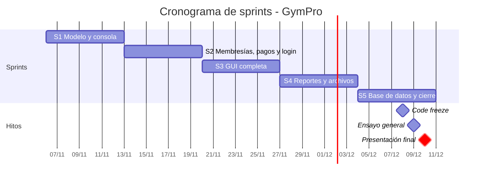
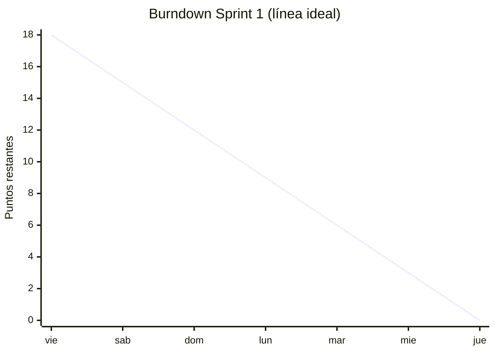

# GymPro — Plan Scrum y planificación del proyecto

**Universidad Nacional de San Agustín de Arequipa**
Curso: *Desarrollo de Software Orientado a Objetos* (2501211) — 2026-B
Proyecto final "GymPro" — Equipo de 3 integrantes

> Documento relacionado: [Especificación del sistema](Especificacion_GymPro.md)

---

## Índice

1. [Resumen del plan](#1-resumen-del-plan)
2. [Calendario general](#2-calendario-general)
3. [Equipo y roles](#3-equipo-y-roles)
4. [Eventos de Scrum y horario semanal](#4-eventos-de-scrum-y-horario-semanal)
5. [Artefactos de Scrum](#5-artefactos-de-scrum)
6. [Estimación: puntos, capacidad y velocidad](#6-estimación-puntos-capacidad-y-velocidad)
7. [Product Backlog](#7-product-backlog)
8. [Definition of Ready y Definition of Done](#8-definition-of-ready-y-definition-of-done)
9. [Plan detallado de cada sprint](#9-plan-detallado-de-cada-sprint)
10. [Tablero Kanban y reglas de trabajo](#10-tablero-kanban-y-reglas-de-trabajo)
11. [Flujo de trabajo con Git y GitHub](#11-flujo-de-trabajo-con-git-y-github)
12. [Seguimiento: burndown y velocidad](#12-seguimiento-burndown-y-velocidad)
13. [Gestión de riesgos](#13-gestión-de-riesgos)
14. [Plan de comunicación](#14-plan-de-comunicación)
15. [Plantillas](#15-plantillas)
16. [Presentación final (jueves 10/12)](#16-preparación-de-la-presentación-final-jueves-1012)
17. [Ciclo de vida y relación con el sílabo](#17-ciclo-de-vida-y-relación-con-el-sílabo-tema-16)

---

## 1. Resumen del plan

| Aspecto | Valor |
|---|---|
| Metodología | Scrum adaptado a un equipo académico de 3 personas |
| Ciclo de vida | Iterativo e incremental: consola → GUI → archivos → base de datos |
| Duración del sprint | 1 semana (7 días), de **viernes a jueves** |
| Último día de cada sprint | **Jueves** (Sprint Review + Retrospectiva) |
| Cantidad de sprints | 5 |
| Inicio | Viernes 06/11/2026 (día siguiente al 2do parcial) |
| Fin del Sprint 1 | **Jueves 12/11/2026** |
| Fin del proyecto | Jueves 10/12/2026 (fin del Sprint 5, presentación y tercera evaluación) |
| Backlog total | 94 puntos de historia (22 elementos) |
| Velocidad meta | ~19 puntos por sprint |

> **Idea central:** los sprints siguen el avance del curso. Lo que se enseña en clase durante la semana se aplica en el sprint de esa misma semana o de la siguiente (GUI → archivos → base de datos).

---

## 2. Calendario general

| Sprint | Inicio (vie) | Fin (jue) | Tema del curso | Objetivo del incremento | Pts |
|---|---|---|---|---|---|
| **S1** | 06/11/2026 | 12/11/2026 | Temas 1-10 (repaso), inicio GUI (12) | Modelo de clases y primeras funciones en consola | 18 |
| **S2** | 13/11/2026 | 19/11/2026 | GUI fundamentos (12) | Membresías, pagos, vencimientos + login gráfico | 19 |
| **S3** | 20/11/2026 | 26/11/2026 | GUI avanzada (13) | Aplicación gráfica completa: miembros, planes, entrenadores, rutinas | 19 |
| **S4** | 27/11/2026 | 03/12/2026 | Archivos (14) | Reportes, gráficos, archivos de texto, binarios y de objetos | 19 |
| **S5** | 04/12/2026 | 10/12/2026 | BD y JDBC (15), ágiles (16) | Base de datos, pruebas finales, documento y **presentación** | 19 |



### Hitos importantes

| Fecha | Hito |
|---|---|
| jue 12/11 | Fin S1: modelo de clases en Java funcionando en consola. |
| jue 19/11 | Fin S2: ciclo completo de membresía (contratar, pagar, vencer). |
| jue 26/11 | Fin S3: aplicación Swing navegable con todas las pestañas. |
| jue 03/12 | Fin S4: los datos se guardan en archivos; reportes con gráficos. |
| mar 08/12 | **Code freeze:** desde esta fecha sólo se corrigen errores, no se agregan funciones. |
| mié 09/12 | Ensayo general de la presentación. |
| jue 10/12 | Fin S5: entrega final y presentación del proyecto. |

---

## 3. Equipo y roles

En Scrum, el Product Owner (PO) y el Scrum Master (SM) son personas distintas y el resto es el equipo de desarrollo. En un equipo de 3 personas, los tres programan y además dos asumen un rol de Scrum. Reemplazar "Integrante 1/2/3" por los nombres reales.

### Integrante 1 (I1) — Product Owner + desarrollador de lógica de negocio

**Rol Scrum**
- Representa al "dueño del gimnasio" (el cliente).
- Mantiene y ordena el Product Backlog por prioridad.
- Escribe y aclara los criterios de aceptación.
- Acepta o rechaza las historias en la Sprint Review.

**Área técnica principal**
- Planes, membresías y pagos (`Plan` y subclases, `Membresia`, `Pago`).
- Clase `Gimnasio` (servicio) y `ServicioReportes`.
- Reglas de negocio: importes, descuentos, vencimientos.

### Integrante 2 (I2) — Scrum Master + desarrollador de interfaz gráfica

**Rol Scrum**
- Organiza y modera todos los eventos (planning, daily, review, retro).
- Elimina impedimentos (bloqueos) y cuida que se cumpla el horario.
- Actualiza el tablero, el burndown y el registro de velocidad.
- Protege al equipo de cambios de alcance a mitad del sprint.

**Área técnica principal**
- Interfaz Swing: `VentanaLogin`, `VentanaPrincipal` y paneles.
- Modelos de tabla, renderers, gráficos (`GraficoBarras`).
- Integración final de todas las partes.

### Integrante 3 (I3) — Desarrollador de modelo, persistencia y calidad (QA)

**Área técnica principal**
- Personas y entrenamiento (`Persona`, `Miembro` y subclases, `Entrenador`, `Rutina`, `DetalleRutina`, `Ejercicio`).
- Utilidades (`Validador`, `Ordenamiento`, `Busqueda`) y excepciones.
- Persistencia: archivos de texto, binarios, de objetos y JDBC/DAO.
- Responsable de pruebas: mantiene la lista de casos de prueba y verifica cada historia antes de pasarla a "Hecho".

### Reglas del equipo

- Nadie trabaja solo en "su" parte: toda tarea se revisa por otro integrante (revisión cruzada en el Pull Request).
- Cada integrante dedica como mínimo **9 horas por semana** al proyecto.
- Los roles de PO y SM se pueden rotar a mitad del proyecto (desde el S3) si el equipo lo decide en la retrospectiva.

---

## 4. Eventos de Scrum y horario semanal

Todos los sprints tienen el mismo ritmo semanal. Ajustar las horas al horario de clases del grupo (el curso tiene clases lunes/jueves, lunes/martes o martes/miércoles según el docente).

| Día | Evento | Duración | Modalidad | Responsable |
|---|---|---|---|---|
| **Viernes** (día 1) | Sprint Planning | 60 min | Meet / presencial | SM modera, PO prioriza |
| Sábado | Daily asíncrona | — | Grupo WhatsApp | Todos |
| Domingo | Descanso o trabajo libre (daily opcional) | — | — | — |
| Lunes | Daily síncrona | 10 min | Meet / tras clase | SM |
| Martes | Daily asíncrona + Refinamiento del backlog | 20 min | Meet | PO + todos |
| Miércoles | Daily síncrona · **límite para abrir los Pull Requests** | 10 min | Meet / tras clase | SM |
| **Jueves** (último día) | Daily + integración | 15 min | Meet | SM |
| | Sprint Review | 40 min | Meet / presencial | PO |
| | Retrospectiva | 20 min | Meet | SM |

### 4.1 Sprint Planning (viernes, 60 min)

- **Entrada:** Product Backlog ordenado, velocidad del sprint anterior, disponibilidad de cada integrante en la semana.
- **Parte 1 — ¿QUÉ? (25 min):** el PO presenta las historias prioritarias; el equipo elige cuántas entran según su capacidad y redacta el **objetivo del sprint** (una frase).
- **Parte 2 — ¿CÓMO? (35 min):** cada historia se divide en tareas de 1 a 4 horas; cada integrante toma tareas y estima sus horas.
- **Salida:** Sprint Backlog en el tablero y objetivo del sprint escrito.

### 4.2 Daily Scrum (todos los días, máx. 10 min o un mensaje)

Cada integrante responde tres preguntas (plantilla en la [sección 15](#151-daily-mensaje-en-el-grupo)):

1. ¿Qué hice desde la última daily?
2. ¿Qué haré hasta la próxima?
3. ¿Tengo algún impedimento?

Las dailies asíncronas se escriben en el grupo antes de las 22:00. Si alguien escribe un impedimento, el SM lo atiende ese mismo día.

### 4.3 Refinamiento del backlog (martes, 20 min)

- Se revisan las historias de los siguientes 1-2 sprints.
- Se aclaran dudas, se escriben criterios de aceptación y se estiman con Planning Poker.
- Se verifica que las historias cumplan la Definition of Ready.

### 4.4 Sprint Review (jueves, 40 min)

- Demostración del incremento **funcionando** (no diapositivas).
- El PO revisa cada historia contra sus criterios de aceptación: **aceptada** (cumple todo) o **rechazada** (vuelve al backlog).
- Se actualiza el backlog con lo aprendido (nuevas ideas o cambios).
- Si es posible, invitar a un compañero de otro grupo o al docente como "cliente" para recibir opiniones.

### 4.5 Retrospectiva (jueves, 20 min)

- Formato "Empezar / Dejar de / Continuar" (plantilla en la [sección 15](#154-retrospectiva-empezar--dejar-de--continuar)).
- Se elige **una** mejora concreta y medible para el siguiente sprint.
- Lo dicho en la retro no se usa para culpar a nadie.

---

## 5. Artefactos de Scrum

| Artefacto | Dónde se guarda | Compromiso asociado |
|---|---|---|
| Product Backlog | GitHub Projects (o Trello) y [sección 7](#7-product-backlog) | Objetivo del producto |
| Sprint Backlog | Columna "Por hacer" del tablero del sprint actual | Objetivo del sprint |
| Incremento | Rama `main` de GitHub con un tag por sprint (`v0.1` … `v1.0`) | Definition of Done |

> **Objetivo del producto:** "Entregar el 10/12/2026 un sistema de escritorio en Java que permita administrar miembros, membresías, pagos, entrenadores y rutinas de un gimnasio, con reportes de ingresos y persistencia en archivos y base de datos, aplicando todos los temas del curso."

**Artefactos de apoyo** (no oficiales de Scrum, pero útiles):

- Gráfico burndown de cada sprint ([sección 12](#12-seguimiento-burndown-y-velocidad)).
- Registro de velocidad ([sección 12](#122-registro-de-velocidad)).
- Registro de riesgos ([sección 13](#13-gestión-de-riesgos)).
- Actas de review y retrospectiva (carpeta `docs/actas` en el repositorio).
- Diagrama UML actualizado al final de cada sprint.

---

## 6. Estimación: puntos, capacidad y velocidad

### 6.1 Puntos de historia (escala Fibonacci)

| Puntos | Tamaño | Referencia |
|---|---|---|
| 1 | Trivial | Menos de 1 hora |
| 2 | Sencilla | 1-2 horas |
| 3 | Pequeña: una clase o una pantalla simple | 2-4 horas |
| 5 | Mediana: varias clases o pantalla con lógica | 4-7 horas |
| 8 | Grande: toca varias capas (modelo + servicio + GUI) | 7-12 horas |
| 13 | Demasiado grande | **Se debe dividir** antes de entrar a un sprint |

### 6.2 Planning Poker

Cada integrante elige su estimación en secreto (cartas, papel o la app "Planning Poker Online"). Se muestran al mismo tiempo. Si hay diferencias, explican sus razones quien puso el número más alto y quien puso el más bajo, y se vota otra vez (máximo 3 rondas). Si no hay acuerdo, se usa el mayor.

### 6.3 Capacidad del equipo por sprint

| Integrante | Horas/semana | Horas efectivas (× 0.8) |
|---|---|---|
| I1 | 10 | 8 |
| I2 | 10 | 8 |
| I3 | 10 | 8 |
| **Total** | **30** | **24 horas efectivas por sprint** |

El factor 0.8 descuenta reuniones, dudas y tiempos muertos. En semanas de exámenes de otros cursos, reducir la capacidad (por ejemplo, al 60 %) y comprometer menos puntos.

### 6.4 Velocidad

- Velocidad inicial supuesta: **18-19 puntos por sprint**.
- Desde el Sprint 2 se usa la velocidad **real** promedio de los sprints anteriores (sólo cuentan las historias **aceptadas** en la review).

---

## 7. Product Backlog

Ordenado por prioridad (el orden lo decide el PO).
**HU** = historia de usuario · **HT** = historia técnica (trabajo necesario que no ve el usuario final) · **HG** = historia de interfaz gráfica.

| ID | Historia | Prioridad | Pts | Sprint |
|---|---|---|---|---|
| HT-01 | Configurar repositorio, estructura de paquetes y tablero | Alta | 2 | S1 |
| HT-02 | Implementar el modelo de clases base según el UML | Alta | 5 | S1 |
| HT-03 | Implementar utilidades (Validador, Ordenamiento, Busqueda) y excepciones propias | Alta | 3 | S1 |
| HU-04 | Como administrador quiero crear planes mensuales, trimestrales y anuales | Alta | 3 | S1 |
| HU-01 | Como recepcionista quiero registrar miembros | Alta | 5 | S1 |
| HU-02 | Como recepcionista quiero contratar un plan y registrar el pago | Alta | 8 | S2 |
| HU-03 | Como recepcionista quiero ver el estado y la fecha de vencimiento de un miembro | Alta | 3 | S2 |
| HU-05 | Como administrador quiero ver las membresías vencidas y las próximas a vencer | Alta | 5 | S2 |
| HU-12 | Como usuario quiero iniciar sesión según mi rol | Media | 3 | S2 |
| HG-01 | Como usuario quiero una ventana principal con pestañas para miembros, planes y pagos | Alta | 5 | S3 |
| HU-06 | Como administrador quiero registrar entrenadores y sus especialidades | Media | 3 | S3 |
| HU-07 | Como administrador quiero asignar entrenadores a miembros | Media | 3 | S3 |
| HU-08 | Como entrenador quiero crear rutinas con ejercicios, series y repeticiones | Media | 8 | S3 |
| HU-09 | Como entrenador quiero consultar el historial de rutinas | Media | 3 | S4 |
| HU-10 | Como administrador quiero ver los ingresos por periodo con gráficos | Media | 8 | S4 |
| HU-11 | Como administrador quiero conocer los planes más solicitados | Media | 3 | S4 |
| HU-13 | Como administrador quiero respaldar, importar y exportar datos (archivos) | Media | 5 | S4 |
| HU-14 | Como administrador quiero que los datos se guarden en una base de datos | Alta | 8 | S5 |
| HU-15 | Como miembro quiero recibir mi comprobante y mi rutina en un archivo de texto | Baja | 3 | S5 |
| HT-05 | Cargar datos de prueba (miembros, planes, pagos) para la demostración | Media | 2 | S5 |
| HT-06 | Documento final, diagrama UML final y manual de usuario | Alta | 3 | S5 |
| HT-07 | Preparar diapositivas, guion y ensayo de la presentación | Alta | 3 | S5 |
| | | **Total** | **94** | |

**Puntos por sprint:** S1 = 18 · S2 = 19 · S3 = 19 · S4 = 19 · S5 = 19

### 7.1 Criterios de aceptación

#### HT-01 — Configurar repositorio (2 pts)
- [ ] Repositorio privado en GitHub con los 3 integrantes y el README.
- [ ] Ramas `main` y `develop` creadas; `main` protegida (sólo se modifica por PR).
- [ ] Estructura de paquetes `src/gympro/...` según la especificación y un `.gitignore` para Java.
- [ ] Tablero del proyecto creado con las columnas de la [sección 10](#10-tablero-kanban-y-reglas-de-trabajo).
- [ ] Los 3 integrantes clonaron el proyecto y lo compilan en su IDE.

#### HT-02 — Modelo de clases base (5 pts)
- [ ] Clases `Persona`, `Miembro` (y 3 subclases), `Entrenador`, `Plan` (y 3 subclases), `Membresia`, `Pago`, `Ejercicio`, `DetalleRutina` y `Rutina` con atributos privados, constructores, getters/setters y `toString()`.
- [ ] Enumeraciones creadas (`EstadoMembresia`, `MetodoPago`, `Especialidad`, etc.).
- [ ] Interfaces `Descontable` y `Reportable` implementadas.
- [ ] Compila sin errores y coincide con el diagrama UML.

#### HT-03 — Utilidades y excepciones (3 pts)
- [ ] `Validador` lanza `DatosInvalidosException` con DNI de longitud distinta de 8, email sin "@" o teléfono de longitud distinta de 9.
- [ ] Ordenamiento por selección, inserción y burbuja escritos a mano.
- [ ] Búsqueda binaria por DNI devuelve el índice o −1.
- [ ] Jerarquía `GimnasioException` con sus 6 subclases.

#### HU-04 — Crear planes (3 pts)
- [ ] Se crean planes MENSUAL, TRIMESTRAL y ANUAL con un precio mensual base.
- [ ] Con precio base S/ 120: mensual = 120.00, trimestral = 324.00, anual = 1152.00 (polimorfismo con `calcularImporte()`).
- [ ] No se permite precio negativo ni nombre vacío.
- [ ] Desde la consola se pueden listar los planes con su importe.

#### HU-01 — Registrar miembros (5 pts)
- [ ] Se registran miembros REGULAR, ESTUDIANTE y CORPORATIVO.
- [ ] Se valida DNI (8 dígitos y único), email y teléfono.
- [ ] El código se genera automáticamente (M0001, M0002, …).
- [ ] Se busca un miembro por DNI y se muestran sus datos.
- [ ] Funciona desde `MenuConsola` (en el S3 se pasa a la GUI).

#### HU-02 — Contratar membresía y registrar pago (8 pts)
- [ ] Se elige miembro, plan y método de pago; se muestra el desglose (plan, descuento, matrícula, recargo, total).
- [ ] Caso de prueba: estudiante + trimestral + primera vez + tarjeta = **S/ 335.16**.
- [ ] La matrícula (S/ 50) sólo se cobra en la primera membresía.
- [ ] Si el miembro ya tiene una membresía vigente se lanza `MembresiaActivaException` y se ofrece "renovar".
- [ ] La renovación empieza el día siguiente al fin de la membresía vigente.
- [ ] El pago queda guardado en la lista de pagos del gimnasio.

#### HU-03 — Ver estado y vencimiento (3 pts)
- [ ] Al buscar un miembro se ve: estado (ACTIVO, POR_VENCER, VENCIDO, SIN_MEMBRESIA), fecha de vencimiento y días restantes.
- [ ] Se muestra el historial de membresías ordenado por fecha.

#### HU-05 — Membresías vencidas y por vencer (5 pts)
- [ ] Al iniciar el sistema se actualizan los estados automáticamente.
- [ ] Lista de membresías que vencen en los próximos N días (N = 7 por defecto, configurable).
- [ ] Lista de membresías vencidas, ordenada por fecha de fin (inserción).
- [ ] Lista de miembros activos.

#### HU-12 — Iniciar sesión según rol (3 pts)
- [ ] Ventana de login con usuario y contraseña (`JPasswordField`).
- [ ] 3 usuarios de prueba: admin, recepcion, entrenador.
- [ ] Credenciales incorrectas muestran un mensaje con `JOptionPane`.
- [ ] Según el rol se habilitan u ocultan opciones (por ejemplo, el entrenador no ve los reportes de ingresos).

#### HG-01 — Ventana principal con pestañas (5 pts)
- [ ] `JFrame` con `JMenuBar`, `JTabbedPane` y barra de estado (usuario y reloj).
- [ ] Pestaña Miembros: `JTable` con búsqueda en vivo, botones Nuevo / Editar / Dar de baja y formulario en `JDialog`.
- [ ] Pestaña Planes y Pagos: contratar o renovar con el importe recalculado al cambiar de plan o de método de pago.
- [ ] Filas de color: verde (activo), amarillo (por vencer), rojo (vencido).

#### HU-06 — Registrar entrenadores (3 pts)
- [ ] Formulario con especialidades (`JCheckBox`) y turno (`JComboBox`).
- [ ] Disponibilidad semanal en una grilla 7 × 3 (arreglo 2D `boolean`).
- [ ] Búsqueda de entrenadores por especialidad.

#### HU-07 — Asignar entrenadores (3 pts)
- [ ] Se asigna un entrenador a un miembro con membresía activa.
- [ ] Máximo 15 miembros por entrenador (`EntrenadorSinCupoException`).
- [ ] Se puede reasignar: el miembro sale de la lista del entrenador anterior.

#### HU-08 — Crear rutinas (8 pts)
- [ ] Se elige un miembro activo y se crea una rutina con nombre y objetivo.
- [ ] Se agregan ejercicios del catálogo con día, series (1-10), repeticiones (1-50), peso y descanso.
- [ ] Máximo 20 ejercicios (arreglo parcialmente lleno; `RutinaLlenaException`).
- [ ] Se puede quitar un ejercicio y ordenar la rutina por día.
- [ ] Al asignar una rutina nueva, la anterior queda en el historial.

#### HU-09 — Historial de rutinas (3 pts)
- [ ] Se listan todas las rutinas del miembro con fecha y estado.
- [ ] Al seleccionar una se ven sus ejercicios.

#### HU-10 — Ingresos por periodo con gráficos (8 pts)
- [ ] Ingresos entre dos fechas y por mes/año.
- [ ] Tabla de 12 meses × 3 tipos de plan con totales (arreglo 2D).
- [ ] Gráfico de barras dibujado con `paintComponent`.
- [ ] El reporte se exporta a `.txt` con `JFileChooser`.

#### HU-11 — Planes más solicitados (3 pts)
- [ ] Conteo por plan con `HashMap<String, Integer>` y porcentaje.
- [ ] Ranking ordenado de mayor a menor y gráfico de barras.

#### HU-13 — Respaldo, importación y exportación (5 pts)
- [ ] Exportar e importar miembros en CSV (las líneas con error se reportan y no detienen la importación).
- [ ] Respaldo completo en `respaldo_gympro.dat` (`ObjectOutputStream`) y restauración.
- [ ] Cada pago se agrega a `pagos.bin` (`DataOutputStream`) y se puede leer.
- [ ] Al cerrar la ventana se pregunta si se desea guardar.

#### HU-14 — Base de datos (8 pts)
- [ ] Script `gympro.sql` con las tablas y datos de ejemplo.
- [ ] `ConexionBD` (Singleton) y DAOs con `PreparedStatement`.
- [ ] Contratar membresía + pago se guarda en una transacción (`commit` / `rollback`).
- [ ] Si la BD no está disponible, el sistema trabaja con el respaldo `.dat` y avisa al usuario.

#### HU-15 — Comprobante y rutina en archivo (3 pts)
- [ ] Al registrar un pago se genera `reportes/comprobante_Pxxxx.txt`.
- [ ] Botón "Exportar rutina" genera `reportes/rutina_Mxxxx.txt` legible.

#### HT-05 — Datos de prueba (2 pts)
- [ ] Al menos 20 miembros, 3 entrenadores, 3 planes, 30 pagos repartidos en varios meses, 15 ejercicios y 5 rutinas.
- [ ] Hay casos de membresías vencidas, por vencer y activas para la demo.

#### HT-06 — Documentación final (3 pts)
- [ ] Documento de especificación actualizado con lo que realmente se hizo.
- [ ] Diagrama UML final coincide con el código.
- [ ] Manual de usuario breve con capturas de pantalla.
- [ ] README con instrucciones para compilar, ejecutar y crear la BD.

#### HT-07 — Presentación (3 pts)
- [ ] Diapositivas (máximo 12) y guion de la demostración.
- [ ] Ensayo completo cronometrado el miércoles 09/12.
- [ ] Video de respaldo de la demo por si falla algo el día 10/12.

---

## 8. Definition of Ready y Definition of Done

### 8.1 Definition of Ready — una historia puede entrar al sprint si…

- [ ] Está escrita con el formato "Como *rol* quiero *acción* para *fin*".
- [ ] Tiene criterios de aceptación claros y verificables.
- [ ] Está estimada y vale 8 puntos o menos.
- [ ] Sus dependencias están resueltas (por ejemplo, HU-02 necesita HU-01 y HU-04 terminadas).
- [ ] El equipo entiende qué temas del curso necesita (si no se vieron en clase, se agenda una tarea de investigación).

### 8.2 Definition of Done — una historia está TERMINADA cuando…

- [ ] El código compila sin errores ni advertencias importantes.
- [ ] Cumple **todos** sus criterios de aceptación.
- [ ] Atributos privados, nombres en camelCase y PascalCase, sin código repetido evidente, con Javadoc en las clases y métodos públicos.
- [ ] Los errores del usuario se manejan con excepciones y mensajes claros (el programa no se cae).
- [ ] Se probó con los casos de prueba de la historia y pasaron (verificado por I3 o por alguien distinto al autor).
- [ ] El Pull Request fue revisado y aprobado por otro integrante y fusionado en `develop`.
- [ ] El diagrama UML se actualizó si se agregaron o cambiaron clases.
- [ ] El PO la aceptó en la Sprint Review.

### 8.3 Definition of Done del incremento (fin de cada sprint)

- [ ] `develop` se fusiona en `main` y se crea el tag `v0.N` (`v1.0` en el S5).
- [ ] La aplicación arranca desde `Main` sin errores en las 3 computadoras.

---

## 9. Plan detallado de cada sprint

Formato de las tareas: responsable, descripción y horas estimadas. Las horas son orientativas; se ajustan en cada Sprint Planning.

### Sprint 1 — vie 06/11 al jue 12/11/2026 · 18 puntos · `v0.1`

> **Objetivo:** "Tener el modelo de clases del gimnasio implementado en Java y poder registrar miembros y planes desde un menú de consola."

**Historias:** HT-01 (2), HT-02 (5), HT-03 (3), HU-04 (3), HU-01 (5)

| Historia | Resp. | Tarea | Horas |
|---|---|---|---|
| HT-01 | I2 | Crear repositorio, ramas, `.gitignore` y README | 1.5 |
| HT-01 | I2 | Crear tablero en GitHub Projects y cargar el backlog | 1 |
| HT-01 | I1, I3 | Clonar, configurar el IDE y compilar | 0.5 c/u |
| HT-02 | I3 | `Persona`, `Miembro` y subclases, `Entrenador` | 3 |
| HT-02 | I1 | `Plan` y subclases, `Membresia`, `Pago` | 3 |
| HT-02 | I3 | `Ejercicio`, `DetalleRutina`, `Rutina` con arreglo parcial | 2.5 |
| HT-02 | I2 | Enumeraciones e interfaces `Descontable` y `Reportable` | 1 |
| HT-03 | I3 | `Validador` y jerarquía de excepciones | 1.5 |
| HT-03 | I2 | `Ordenamiento` y `Busqueda` (métodos estáticos) | 2 |
| HU-04 | I1 | `calcularImporte()` polimórfico y validaciones | 1.5 |
| HU-04 | I1 | Prueba: los 3 importes de ejemplo | 0.5 |
| HU-01 | I1 | `Gimnasio.registrarMiembro` / `buscarMiembro` con `HashMap` | 2 |
| HU-01 | I2 | `MenuConsola`: opciones registrar, buscar y listar | 2 |
| HU-01 | I3 | Pruebas CP-01, CP-02 y CP-14 | 1 |
| — | Todos | Planning, dailies, review y retro | 2 c/u |

**Carga:** I1 ≈ 9.5 h · I2 ≈ 9.5 h · I3 ≈ 10 h

**Demo del jueves 12/11:** ejecutar `MenuConsola`; registrar 3 miembros de tipos distintos; intentar uno con DNI inválido (se ve el mensaje); crear los 3 planes y listar sus importes; buscar un miembro por DNI.

### Sprint 2 — vie 13/11 al jue 19/11/2026 · 19 puntos · `v0.2`

> **Objetivo:** "Completar el ciclo de vida de una membresía (contratar, pagar, renovar, vencer) y entrar al sistema con una ventana de login."

**Historias:** HU-02 (8), HU-03 (3), HU-05 (5), HU-12 (3)

| Historia | Resp. | Tarea | Horas |
|---|---|---|---|
| HU-02 | I1 | Constructor de `Pago` con desglose y `calcularTotal()` | 2 |
| HU-02 | I1 | `Gimnasio.contratarMembresia` y `renovarMembresia` | 3 |
| HU-02 | I2 | Opción "contratar / renovar" en `MenuConsola` | 1.5 |
| HU-02 | I3 | Pruebas CP-03 a CP-07 | 2 |
| HU-03 | I3 | `getEstadoInscripcion()`, `getDiasRestantes()`, historial | 2 |
| HU-03 | I2 | Mostrar la ficha del miembro en consola | 1 |
| HU-05 | I1 | `actualizarEstadosMembresias()` y listas de vencidas y por vencer | 2.5 |
| HU-05 | I3 | Ordenar vencimientos por inserción y probar CP-08 y CP-09 | 1.5 |
| HU-12 | I2 | Clase `Usuario` y `VentanaLogin` con `GridLayout` y `ActionListener` | 3 |
| HU-12 | I2 | Abrir una ventana principal vacía según el rol | 1 |
| — | Todos | Eventos Scrum | 2 c/u |

**Carga:** I1 ≈ 9.5 h · I2 ≈ 8.5 h · I3 ≈ 9.5 h

**Demo del jueves 19/11:** login gráfico con los 3 roles; en consola, contratar una membresía con el desglose del ejemplo (S/ 335.16), intentar contratar otra (error), renovar, y ver las listas de vencidas y por vencer.

### Sprint 3 — vie 20/11 al jue 26/11/2026 · 19 puntos · `v0.3`

> **Objetivo:** "Que todo el sistema se use desde la interfaz gráfica: miembros, planes y pagos, entrenadores y rutinas."

**Historias:** HG-01 (5), HU-06 (3), HU-07 (3), HU-08 (8)

| Historia | Resp. | Tarea | Horas |
|---|---|---|---|
| HG-01 | I2 | `VentanaPrincipal`: `JMenuBar`, `JTabbedPane`, barra de estado con `Timer` | 2 |
| HG-01 | I2 | `PanelMiembros` con `MiembroTableModel`, búsqueda en vivo y `DialogoMiembro` | 3 |
| HG-01 | I1 | `PanelPlanesPagos` con recálculo en vivo (`ItemListener`) | 3 |
| HG-01 | I2 | `EstadoCellRenderer` con colores | 1 |
| HU-06 | I3 | `PanelEntrenadores`: `JCheckBox` de especialidades y grilla 7×3 | 2.5 |
| HU-07 | I3 | `asignarEntrenador` con control de cupo + botón en la GUI | 2 |
| HU-08 | I1 | `Gimnasio.crearRutina` y catálogo de ejercicios | 2 |
| HU-08 | I3 | `PanelRutinas`: `JList` del catálogo, `JSpinner`, `JTable` y `JProgressBar` | 3.5 |
| HU-08 | I1 | Pruebas CP-10 a CP-13 | 1.5 |
| — | Todos | Eventos Scrum | 2 c/u |

**Carga:** I1 ≈ 8.5 h · I2 ≈ 8 h · I3 ≈ 10 h

**Demo del jueves 26/11:** flujo completo en la GUI: login, registrar miembro, contratar plan, registrar entrenador, asignarlo y crear una rutina de 5 ejercicios.

### Sprint 4 — vie 27/11 al jue 03/12/2026 · 19 puntos · `v0.4`

> **Objetivo:** "Que los datos no se pierdan al cerrar el programa y que el administrador tenga reportes y gráficos de ingresos."

**Historias:** HU-09 (3), HU-10 (8), HU-11 (3), HU-13 (5)

| Historia | Resp. | Tarea | Horas |
|---|---|---|---|
| HU-09 | I3 | Pestaña interna "Historial" en `PanelRutinas` | 2 |
| HU-10 | I1 | `ServicioReportes`: ingresos por periodo, mensuales y matriz 12×3 | 3 |
| HU-10 | I2 | `GraficoBarras` con `paintComponent` | 2.5 |
| HU-10 | I2 | `PanelReportes` con `JSpinner` de fechas, `JTable` y exportar `.txt` | 2.5 |
| HU-11 | I1 | `planesMasSolicitados()` con `HashMap` y ranking | 1.5 |
| HU-11 | I2 | `PanelDashboard`: tarjetas e integración de gráficos | 1.5 |
| HU-13 | I3 | `ArchivoTexto`: exportar e importar CSV | 2 |
| HU-13 | I3 | `PersistenciaObjetos` (`.dat`) y `ArchivoBinario` (`pagos.bin`) | 2.5 |
| HU-13 | I1 | Menú Archivo y `WindowListener` para guardar al salir | 1 |
| Extra | I3 | Preparar el script SQL (adelanto de HU-14) | 1 |
| — | Todos | Eventos Scrum | 2 c/u |

**Carga:** I1 ≈ 8.5 h · I2 ≈ 8.5 h · I3 ≈ 9.5 h

**Demo del jueves 03/12:** cerrar y volver a abrir el programa sin perder los datos; dashboard con miembros activos, por vencer e ingresos del mes; reporte de ingresos de noviembre exportado a `.txt`; importar un CSV con una línea con errores (se informa y continúa).

### Sprint 5 — vie 04/12 al jue 10/12/2026 · 19 puntos · `v1.0`

> **Objetivo:** "Guardar la información en una base de datos, dejar el producto pulido y presentarlo con éxito el jueves 10/12."

**Historias:** HU-14 (8), HU-15 (3), HT-05 (2), HT-06 (3), HT-07 (3)

| Historia | Resp. | Tarea | Horas |
|---|---|---|---|
| HU-14 | I3 | `ConexionBD` (Singleton) y DAOs de Miembro, Plan, Membresia y Pago | 4 |
| HU-14 | I3 | DAOs de Entrenador, Rutina y Ejercicio | 2 |
| HU-14 | I1 | `PersistenciaBD` con transacción en contratar membresía | 2 |
| HU-14 | I2 | Menú "Base de datos" y modo sin conexión | 1 |
| HU-15 | I1 | Comprobante y rutina en `.txt` | 1.5 |
| HT-05 | I1 | Clase de datos de prueba y carga inicial | 1.5 |
| HT-06 | I3 | README e instrucciones de la BD | 1 |
| HT-06 | I2 | Manual de usuario con capturas | 1.5 |
| HT-06 | I1 | Actualizar especificación y UML final | 1.5 |
| HT-07 | I2 | Diapositivas y guion | 2 |
| HT-07 | Todos | Grabar el video de respaldo | 1 |
| HT-07 | Todos | Ensayo general el miércoles 09/12 | 1 |

**Carga:** I1 ≈ 10 h · I2 ≈ 8.5 h · I3 ≈ 9 h

**Fechas internas del Sprint 5**

| Fecha | Actividad |
|---|---|
| vie 04/12 | Planning |
| lun 07/12 | HU-14 integrada en `develop` |
| mar 08/12 | **Code freeze**: desde aquí sólo se corrigen errores |
| mié 09/12 | Ensayo general, video de respaldo, tag `v1.0` en `main` |
| jue 10/12 | Presentación (funciona como la Sprint Review final) y retrospectiva final del proyecto |

> **Plan B si la BD se complica:** HU-14 se entrega con `Miembro` y `Pago` en la BD y el resto se guarda en el archivo `.dat`. Se explica en la presentación como decisión del equipo (el PO acepta el alcance reducido).

---

## 10. Tablero Kanban y reglas de trabajo

Herramienta: **GitHub Projects** (vinculado a issues y PRs) o Trello.

| Product Backlog | Por hacer (sprint) | En progreso (máx. 2/persona) | En revisión (PR abierto) | Probado (QA ok) | Hecho |
|---|---|---|---|---|---|
| HU-09 … | HU-02 T1 | HU-02 T2 (I1) | HU-04 T1 | HT-03 | HT-01 |

**Reglas**

1. Cada tarjeta tiene: ID de historia, responsable, estimación y la etiqueta del sprint.
2. **Límite WIP:** máximo 2 tarjetas "En progreso" por persona. Antes de empezar algo nuevo se termina lo que se tiene.
3. Una tarjeta pasa a "En revisión" sólo con un Pull Request abierto.
4. Sólo I3 (o alguien que no sea el autor) mueve tarjetas a "Probado".
5. Sólo el PO mueve historias completas a "Hecho" en la Sprint Review.
6. Si una tarea está bloqueada más de 1 día, se marca con la etiqueta `bloqueado` y se avisa en la daily.

**Etiquetas:** `modelo`, `servicio`, `gui`, `persistencia`, `bd`, `docs`, `bug`, `bloqueado`.

---

## 11. Flujo de trabajo con Git y GitHub

### 11.1 Ramas

| Rama | Uso |
|---|---|
| `main` | Versión estable; sólo cambia al final de cada sprint |
| `develop` | Integración del sprint en curso |
| `feature/HU-02-pago` | Una rama por historia o tarea grande |
| `fix/descripcion` | Corrección de errores |

### 11.2 Ciclo de una tarea

```bash
git checkout develop && git pull
git checkout -b feature/HU-02-pago
# ... programar y hacer commits pequeños y frecuentes ...
git push -u origin feature/HU-02-pago
```

1. Abrir Pull Request hacia `develop`; asignar a otro integrante como revisor.
2. El revisor comenta, prueba y aprueba; el autor fusiona.
3. Borrar la rama y mover la tarjeta.

### 11.3 Mensajes de commit

Formato: `<ID>: <qué se hizo, en presente>`

```
HU-02: agrega cálculo de recargo por tarjeta en Pago
HT-03: implementa búsqueda binaria por DNI
fix: corrige días restantes negativos en Membresia
```

### 11.4 Fin de sprint (jueves, antes de la review)

- Fusionar `develop` en `main`.
- Crear el tag: `v0.1` (S1), `v0.2` (S2), `v0.3` (S3), `v0.4` (S4), `v1.0` (S5).
- Todos descargan `main` y comprueban que compila en su computadora.

### 11.5 Acuerdos para evitar conflictos

- Todos usan el mismo IDE (por ejemplo IntelliJ IDEA o NetBeans) y la misma versión de Java (17 o superior).
- No se suben archivos `.class`, carpetas `out/` o `bin/`, ni datos personales.
- Dos personas no editan la misma clase a la vez sin avisar en el grupo.
- Antes de abrir un PR se hace `git pull` de `develop` y se resuelven los conflictos localmente.

---

## 12. Seguimiento: burndown y velocidad

### 12.1 Burndown del sprint

El SM anota cada día los **puntos que faltan** (sólo cuentan las historias completamente terminadas). La línea ideal baja de forma uniforme.

**Ejemplo — Sprint 1 (18 puntos):**

| Día | vie 06/11 | sáb 07/11 | dom 08/11 | lun 09/11 | mar 10/11 | mié 11/11 | jue 12/11 |
|---|---|---|---|---|---|---|---|
| Ideal | 18 | 15 | 12 | 9 | 6 | 3 | 0 |
| Real | 18 | __ | __ | __ | __ | __ | __ |



Para agregar la línea real, añadir debajo de la línea ideal otra fila `line [18, ...]` con los valores anotados cada día.

**Interpretación**

- **Línea real por encima de la ideal:** el equipo va atrasado; en la daily se decide qué historia sacar o cómo ayudar.
- **Línea real plana varios días:** hay historias "casi terminadas" que no se cierran; terminar antes de empezar otras.

### 12.2 Registro de velocidad

| Sprint | Comprometido | Terminado | Aceptado | Observaciones |
|---|---|---|---|---|
| S1 | 18 | | | |
| S2 | 19 | 19 | 19 | PO ausente en la review; aceptación por SM y QA ([acta](actas/Sprint2_Review.md)) |
| S3 | 19 | | | |
| S4 | 19 | | | |
| S5 | 19 | | | |

Velocidad promedio = suma de "Aceptado" / número de sprints.

### 12.3 Registro de horas (opcional, útil para el informe)

| Integrante | S1 | S2 | S3 | S4 | S5 | Total |
|---|---|---|---|---|---|---|
| I1 | | | | | | |
| I2 | | | | | | |
| I3 | | | | | | |

---

## 13. Gestión de riesgos

Probabilidad e impacto: **A** = alto, **M** = medio, **B** = bajo.

| # | Riesgo | Prob. | Imp. | Mitigación / plan de contingencia |
|---|---|---|---|---|
| R1 | Exámenes de otros cursos reducen las horas disponibles | A | A | Planificar menos puntos esas semanas; avisar en el planning. |
| R2 | Un integrante se enferma o abandona | M | A | Revisión cruzada: los otros dos conocen su código. Redistribuir tareas en la daily. |
| R3 | Temas aún no vistos en clase (GUI avanzada, JDBC) | M | M | Tarea de investigación (spike) de 1-2 h; usar el libro del curso (Aedo, Dean, Deitel). |
| R4 | Conflictos de Git que rompen el código | M | M | Ramas por historia, PRs pequeños, pull frecuente; nunca trabajar directo en `main`. |
| R5 | La BD no funciona en la computadora de la presentación | M | A | Usar SQLite (no necesita servidor) o el plan B de archivos `.dat`; probar en esa computadora el 09/12. |
| R6 | Alcance demasiado grande | M | A | El PO prioriza; las historias de baja prioridad (HU-15) se recortan primero. |
| R7 | Integración tardía de la GUI con la lógica | M | M | Integrar todos los jueves, no sólo al final del proyecto. |
| R8 | Pérdida de código | B | A | Todo está en GitHub; push diario. |

El SM revisa esta tabla en cada retrospectiva y la actualiza.

---

## 14. Plan de comunicación

| Canal | Uso | Frecuencia |
|---|---|---|
| Grupo de WhatsApp | Dailies asíncronas, avisos rápidos, impedimentos | Diario |
| Google Meet / Discord | Planning, dailies síncronas, review, retro, programación en pareja | Lun, mié, vie, jue |
| GitHub Projects | Estado de las tareas (fuente oficial de verdad) | Siempre |
| GitHub Pull Requests | Revisión de código y discusión técnica | Por tarea |
| Carpeta `docs/` del repositorio | Actas, documento, diagramas, diapositivas | Por evento |

**Acuerdos**

- Responder los mensajes del grupo en menos de 12 horas.
- Si alguien no puede asistir a un evento, avisa antes y deja su daily escrita.
- Las decisiones importantes (cambio de alcance, de diseño o de roles) se escriben en el acta correspondiente.

---

## 15. Plantillas

### 15.1 Daily (mensaje en el grupo)

```
DAILY - [nombre] - [fecha]
Ayer     : terminé ____ (tarea / HU-xx)
Hoy      : voy a ____
Bloqueos : ninguno / ____
```

### 15.2 Acta de Sprint Planning

```
SPRINT N - PLANNING - fecha ___     Asistentes: I1 I2 I3
Objetivo del sprint : "______________________________"
Capacidad           : ___ horas | ___ puntos
Historias elegidas  : HU-__ (__ pts), HU-__ (__ pts) ...  Total: __
Riesgos de la semana: ____
```

### 15.3 Acta de Sprint Review

```
SPRINT N - REVIEW - jueves ___
Historia  Resultado (Aceptada / Rechazada)  Observación del PO
HU-__     ______                            ______
Puntos aceptados: __ de __ comprometidos.
Cambios al backlog: ____
```

### 15.4 Retrospectiva (Empezar / Dejar de / Continuar)

```
SPRINT N - RETROSPECTIVA - jueves ___
EMPEZAR a hacer : ____
DEJAR de hacer  : ____
CONTINUAR       : ____
Mejora elegida para el próximo sprint (una sola, medible):
  ____________________________________  Responsable: __
¿Se cumplió la mejora del sprint anterior? Sí / No / Parcial
```

**Otras dinámicas para variar las retros**

- **Velero:** viento (lo que nos impulsó), ancla (lo que nos frenó), rocas (riesgos), isla (meta).
- **Estrella de mar:** más de, menos de, empezar, dejar, continuar.

---

## 16. Preparación de la presentación final (jueves 10/12)

### 16.1 Estructura sugerida (15-20 minutos)

| Minutos | Contenido | Presenta |
|---|---|---|
| 0-2 | Problema y objetivo del sistema GymPro | I1 (PO) |
| 2-5 | Diseño OO: diagrama UML, herencia, polimorfismo, composición y agregación | I3 |
| 5-12 | Demostración en vivo (guion 16.2) | I2 maneja, I1 narra |
| 12-14 | Archivos y base de datos (cómo se guarda todo) | I3 |
| 14-16 | Scrum: sprints, burndown, velocidad, lecciones aprendidas | I2 (SM) |
| 16-20 | Preguntas del jurado | Todos |

### 16.2 Guion de la demostración

1. Login como administrador.
2. Dashboard: miembros activos, por vencer y gráfico de ingresos.
3. Registrar un miembro estudiante (mostrar un error de validación).
4. Contratar un plan trimestral con tarjeta: desglose = **S/ 335.16**.
5. Mostrar el comprobante `.txt` generado.
6. Asignar un entrenador y crear una rutina de 4 ejercicios encadenados.
7. Reportes: ingresos de noviembre, planes más solicitados.
8. Cerrar, volver a abrir y mostrar que los datos siguen (BD).
9. Login como entrenador: no aparece la pestaña de reportes.

### 16.3 Lista de verificación del día

- [ ] Proyecto compilado y probado en la computadora de la presentación.
- [ ] Base de datos creada con datos de prueba (o plan B con `.dat`).
- [ ] Video de respaldo de la demo descargado (sin depender de internet).
- [ ] Diapositivas en PDF en una USB y en la nube.
- [ ] Cada integrante sabe explicar cualquier parte del código (el jurado puede preguntar a cualquiera).

---

## 17. Ciclo de vida y relación con el sílabo (Tema 16)

### 17.1 Proceso de desarrollo aplicado

| Etapa clásica | Cómo se realiza en este proyecto |
|---|---|
| Requerimientos | Product Backlog con historias de usuario y criterios de aceptación (refinamiento de los martes). |
| Análisis y diseño | Diagrama UML (actualizado en cada sprint), diseño en capas. |
| Implementación | Dentro de cada sprint, por historia. |
| Pruebas | Casos de prueba por historia; verificación por I3; Definition of Done. |
| Despliegue | Incremento en `main` con un tag por sprint. |
| Mantenimiento | Correcciones (ramas `fix/`) y mejoras en el backlog. |

A diferencia del modelo en cascada, estas etapas se repiten **en cada sprint** sobre una parte pequeña del sistema (iterativo e incremental), lo que permite mostrar avances reales cada jueves y corregir el rumbo a tiempo.

### 17.2 Valores y principios ágiles que se aplican

- **Software funcionando sobre documentación extensa:** la review es una demo.
- **Colaboración con el cliente:** el PO representa al gimnasio y acepta o rechaza las historias.
- **Responder al cambio:** el backlog se reordena cada semana.
- **Individuos e interacciones:** dailies cortas y retrospectivas.
- **Ritmo sostenible:** unas 10 horas por semana por persona, sin trasnochar el último día.

### 17.3 Evidencias para la evaluación (guardar en `docs/` del repositorio)

- [ ] Este plan y el Product Backlog final.
- [ ] Actas de planning, review y retro de los 5 sprints.
- [ ] Capturas del tablero al inicio y al final de cada sprint.
- [ ] Burndown de cada sprint y registro de velocidad.
- [ ] Historial de commits y Pull Requests en GitHub.
